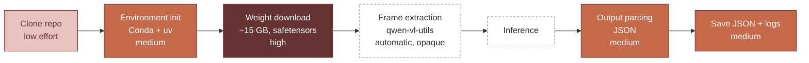
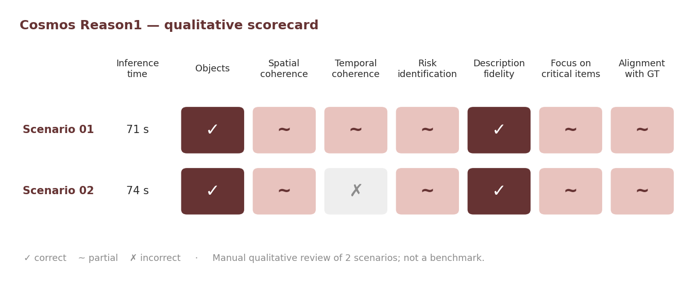

<a id="top"></a>

# Vision Models Evaluation — Cosmos Reason1 & Reason2

> Exploratory evaluation of vision-language models for autonomous driving scene analysis.

**[Overview](#overview)** · **[Models](#models-evaluated)** · **[Pipeline](#pipeline)** · **[Results](#results)** · **[Findings](#technical-findings)** · **[Reproduction](#reproduction)** · **[Limitations](#limitations)**

| | |
|---|---|
| **Problem** | Can recent VLMs reliably describe driving scenes, detect critical road users and identify risks from video? |
| **Approach** | Evaluation spike following NVIDIA's reference implementation: inference on 8 urban scenarios, structured outputs, scoring on 7 criteria. |
| **Key finding** | Reason1 identified objects reliably and stayed faithful to the scene, but only partially captured spatial and temporal dynamics; ~72 s per inference. |
| **Stack** | Cosmos Reason1/Reason2 · Hugging Face · `uv` · Conda · CUDA 11.8 · NVIDIA cloud GPU |
| **Context** | Industrial project — exploratory spike preparing a future formal benchmark. |

## Overview

Vision-language models (VLMs) combine visual inputs with language-based reasoning to describe scenes and interpret driving situations. For driving applications, recognizing objects is not enough: a model must also understand spatial layout, scene dynamics and safety risks.

This project explores the capabilities and limitations of NVIDIA Cosmos Reason1 and Cosmos Reason2 on a mini-dataset of urban driving scenarios. It is an **evaluation spike**: a short, focused investigation that strictly follows NVIDIA's reference implementation, measures the integration effort, and prepares a future formal benchmark.

## Objectives

* Test the models' ability to describe driving scenes correctly.
* Check the detection of critical road users: pedestrians, cyclists, vehicles.
* Assess the spatial and temporal coherence of the predictions.
* Examine scene descriptions for potential hallucinations.
* Measure technical performance: inference time and stability.
* Estimate the integration and preprocessing effort.

## Models Evaluated

| Model          | Size | Strengths observed | Limitations observed |
| -------------- | ---- | ------------------ | -------------------- |
| Cosmos Reason1 | 7B   | Good static-scene understanding, few hallucinations | Weak temporal reasoning, high inference time (~72 s), sensitive to video duration |
| Cosmos Reason2 | 2B   | Code and weights distributed via Hugging Face | Heavy weights (~5 GB), Git LFS and Hugging Face setup required |

These observations come from a limited set of experiments and do not establish a general ranking between the models.

## Data

Eight short video segments representing urban driving situations. Very short clips (a few seconds each) are enough for exploratory testing, but they limit how much temporal reasoning can be assessed.

<details>
<summary><b>Dataset structure</b></summary>

```text
data/
└── raw/
    └── scenarios_demo/
        ├── scenario_01/
        │   └── segment.webm
        ├── scenario_02/
        │   └── segment.webm
        ├── ...
        └── scenario_08/
            └── segment.webm
```

</details>

## Pipeline

The experiments use the original NVIDIA implementations; no custom inference pipeline was built. Each step is colored by the effort it required.



<details>
<summary><b>Effort by step</b></summary>

| Step                    | Performed by             | Effort        | Notes             |
| ----------------------- | ------------------------ | ------------- | ----------------- |
| Repository cloning      | User                     | Low           | `git clone`       |
| Environment init        | User                     | Medium        | Conda + `uv`      |
| Weight download         | Automatic                | High (~15 GB) | Safetensors       |
| Frame extraction (PNG)  | Automatic                | Opaque        | `qwen-vl-utils`   |
| Output parsing          | User                     | Medium        | Final JSON        |
| Saving JSON and logs    | Script + post-processing | Medium        | File organization |

</details>

Both single-scenario and batch inference were run, with inference time measured for each scenario.

## Results

Each output was scored on seven criteria:

* **Objects**: detection of pedestrians, cyclists and vehicles.
* **Spatial coherence**: correct placement of elements in the scene.
* **Temporal coherence**: understanding of scene dynamics.
* **Risk identification**: relevance compared with the ground truth.
* **Description fidelity**: absence of hallucinations.
* **Focus**: attention to critical elements.
* **Alignment with GT**: overall agreement with the expected analysis.



| Scenario | Inference time | Objects identified        | Risk assessed   | Main observation          |
| -------- | -------------: | ------------------------- | --------------- | ------------------------- |
| 01       | 71 s           | pedestrian crossing, road | low             | Risk underestimated       |
| 02       | 74 s           | cyclist, vehicles         | generic caution | Trajectory not understood |

### Observations

Cosmos Reason1 consistently identified the main objects and did not hallucinate elements absent from the scene. Its weaknesses appeared in dynamics: it underestimated the risk at a pedestrian crossing and did not understand a cyclist's trajectory.

The two scored runs took 71 s and 74 s. These timings illustrate the inference-time constraint in the tested environment; they are not general benchmark figures.

## Technical Findings

* Static-scene understanding does not imply reliable temporal reasoning.
* Video duration affects inference behavior and processing time.
* Qualitative inspection is effective for spotting failure cases, but a few scenarios cannot establish general performance.
* Inference time (~72 s) and weight size (~15 GB) are significant integration constraints.
* Part of the preprocessing (frame extraction) is automatic but opaque, which complicates debugging.
* Reproducibility depends on the model version, environment and inference configuration.

## Reproduction

<details>
<summary><b>Experimental environment</b></summary>

| Component            | Configuration                                |
| -------------------- | -------------------------------------------- |
| Operating system     | Ubuntu 22.04                                 |
| Compute environment  | NVIDIA Cloud VM                              |
| GPU                  | NVIDIA Ampere architecture; A100 recommended |
| CUDA                 | 11.8                                         |
| Python               | 3.10.13                                      |
| Conda                | 23.11.0                                      |
| Package management   | `uv`                                         |
| Model ecosystem      | Hugging Face                                 |
| Supporting libraries | `qwen-vl-utils`, `safetensors`               |

A dedicated GPU is strongly recommended.

</details>

<details>
<summary><b>Project structure</b></summary>

```text
Vision_Models_Evaluation/
├── COSMOS_Reason1/
│   ├── scripts/inference.py
│   ├── prompts/driving.yaml
│   └── ...
├── COSMOS_Reason2/
│   ├── code/               # main repository
│   └── models/             # Hugging Face weights
├── data/raw/scenarios_demo/
│   ├── scenario_01/segment.webm
│   └── ... up to scenario_08
└── outputs/
    ├── spike_cosmos_reason1/
    └── spike_cosmos_reason2/
```

</details>

<details>
<summary><b>Run Cosmos Reason1 on one scenario</b></summary>

```bash
uv run scripts/inference.py \
  --prompt prompts/driving.yaml \
  --question "Analyze this driving scene, identify surrounding objects, road context, and potential safety risks." \
  --videos ../data/raw/scenarios_demo/scenario_01/segment.webm \
  -o outputs/spike_cosmos_reason1/scenario_01/analysis.json
```

</details>

<details>
<summary><b>Run Cosmos Reason1 on all 8 scenarios, with timing</b></summary>

```bash
for i in {01..08}; do
  mkdir -p outputs/spike_cosmos_reason1/scenario_$i/artifacts
  /usr/bin/time -f '{"inference_time_sec": %e}' \
  uv run scripts/inference.py \
    --prompt prompts/driving.yaml \
    --question "Analyze this driving scene, identify surrounding objects, road context, and potential safety risks." \
    --videos ../data/raw/scenarios_demo/scenario_$i/segment.webm \
    -o outputs/spike_cosmos_reason1/scenario_$i/analysis.json \
    1> outputs/spike_cosmos_reason1/scenario_$i/raw_stdout.txt \
    2> outputs/spike_cosmos_reason1/scenario_$i/metrics_time.json
done
```

</details>

<details>
<summary><b>Generated outputs</b></summary>

```text
outputs/spike_cosmos_reason1/scenario_01/
├── analysis.json          # model analysis
├── metrics_time.json      # inference time
├── raw_stdout.txt         # raw model output
└── artifacts/video_0/     # extracted frames (0.png, 1.png, ...)
```

</details>

## Technologies

| Category        | Technologies                           |
| --------------- | -------------------------------------- |
| Models          | NVIDIA Cosmos Reason1, Cosmos Reason2  |
| Model ecosystem | Hugging Face, safetensors, Git LFS     |
| Preprocessing   | `qwen-vl-utils`                        |
| Environment     | Python 3.10.13, Conda, `uv`, CUDA 11.8 |
| Compute         | NVIDIA cloud GPU (Ampere / A100)       |

## Key Takeaways

* Evaluating a model means measuring its integration cost, not only its output quality.
* Static visual understanding and temporal reasoning are distinct capabilities and must be tested separately.
* A structured qualitative grid turns subjective impressions into comparable observations.
* Controlled experiments are needed before broader model comparisons.

## Limitations

* Exploratory spike: 8 scenarios run, 2 scored manually. Not a benchmark or a model ranking.
* Qualitative scoring by a single reviewer.
* Inference times depend on the model, hardware, input duration and configuration.
* Reproduction requires compatible GPU resources and correct model-weight setup.

## Future Improvements

* Score all scenarios and add Cosmos Reason2 to the grid.
* Expand the dataset with more varied and challenging driving situations.
* Turn the grid into a structured protocol with consistent prompts and inputs.
* Quantify hallucinations and temporal-reasoning errors.
* Record inference time and resource usage under controlled conditions.

## Author

**Rosette-Michèle Otounga**
Data & AI Engineer · Data Engineering · Applied AI

* [LinkedIn](https://linkedin.com/in/rosette-michele)
* [Portfolio](https://github.com/soley000/omr-portfolio)

<p align="right"><a href="#top">↑ Back to top</a></p>
