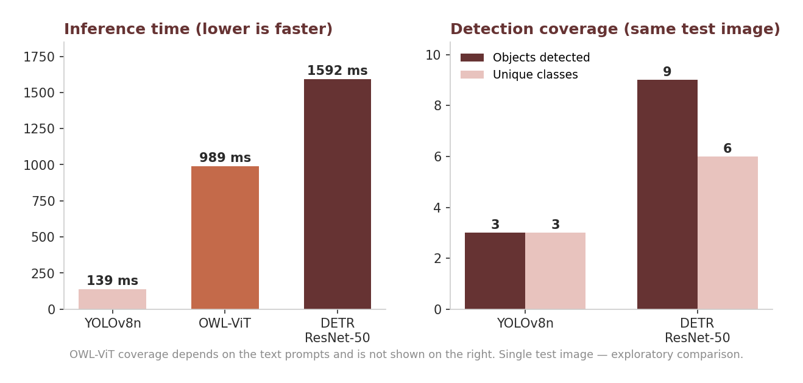
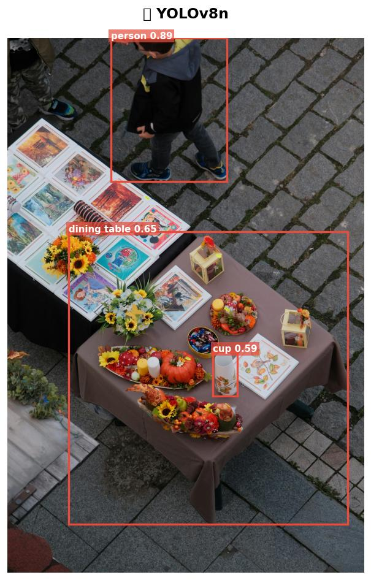
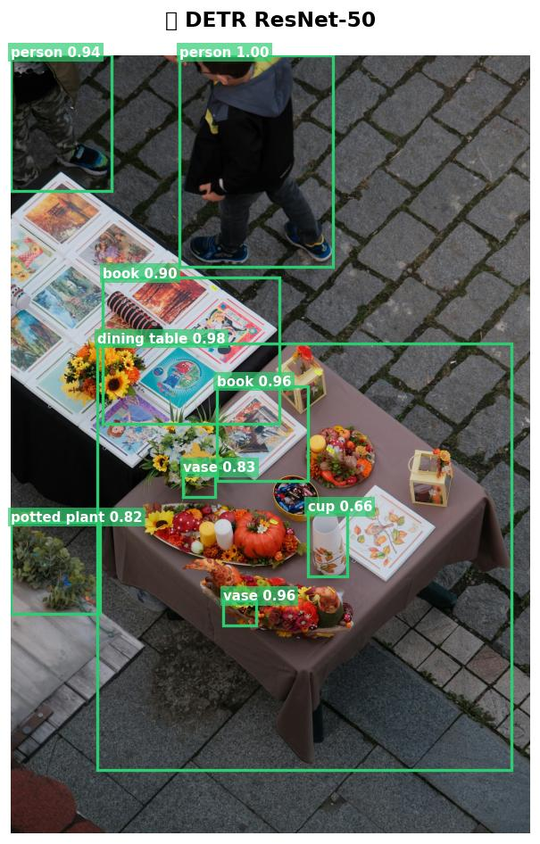
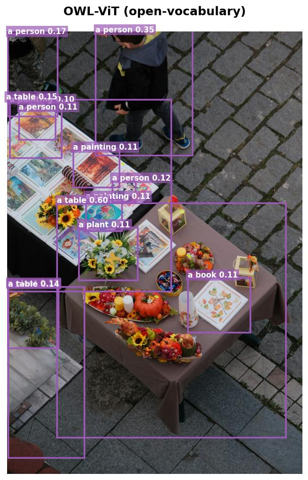
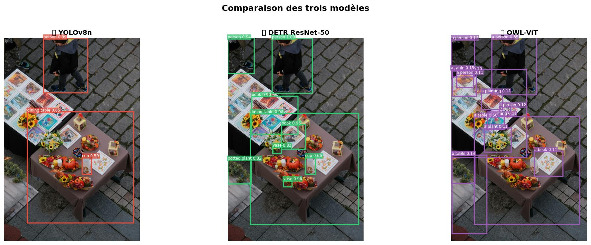
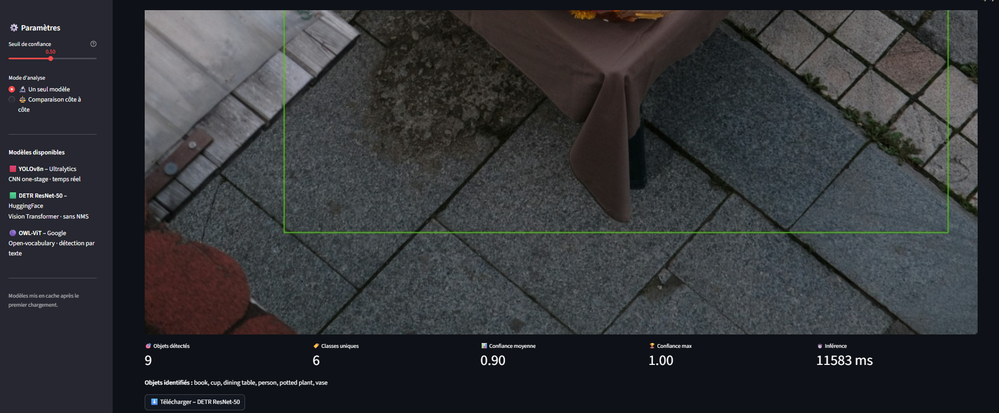
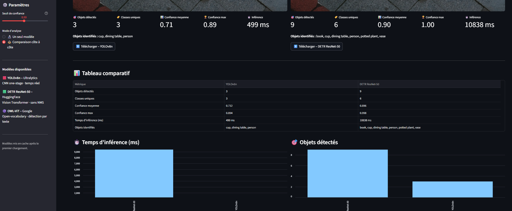

<a id="top"></a>

# Object Detection : YOLOv8, DETR & OWL-ViT

> Computer vision model comparison and interactive inference.

**[Overview](#overview)** · **[Models](#models)** · **[Results](#results)** · **[Application](#application)** · **[Installation](#installation)** · **[Limitations](#limitations)**

| | |
|---|---|
| **Problem** | How do different detection paradigms trade off speed, coverage and flexibility on the same scene? |
| **Approach** | Compared a one-stage CNN, a Transformer detector and an open-vocabulary detector, and built a Streamlit app to run them alone or side by side. |
| **Key result** | YOLOv8n: 139 ms, 3 objects · DETR: 1592 ms, 9 objects (~11× slower) · OWL-ViT: detects any object described in text. |
| **Stack** | Python · PyTorch · Ultralytics · Hugging Face Transformers · OpenCV · Streamlit |
| **Context** | Open source |

## Overview

This project compares three object detection approaches based on different computer vision paradigms:

* **YOLOv8n**: one-stage CNN-based detection;
* **DETR ResNet-50**: Transformer-based detection;
* **OWL-ViT**: open-vocabulary vision-language detection.

The project started with two classic detectors (YOLOv8 and SSD MobileNet), then evolved to explore what recent research brings: Transformer architectures for vision, and detection guided by natural language.

The goal is not to find a single "best" model, but to understand how different architectures behave on the same input, and how their trade-offs affect detection coverage, confidence, inference time and flexibility.

## Objectives

* Compare three detection paradigms using pretrained models.
* Understand the differences between CNN-based, Transformer-based and open-vocabulary detection.
* Evaluate practical trade-offs between coverage, confidence and inference time.
* Provide an interactive interface for visual inspection and model comparison.

## Models

| Model          | Paradigm        | Vocabulary                | Framework    | Main characteristic        |
| -------------- | --------------- | ------------------------- | ------------ | -------------------------- |
| YOLOv8n        | One-stage CNN   | Fixed (80 COCO classes)   | Ultralytics  | Fast, lightweight          |
| DETR ResNet-50 | Transformer     | Fixed (80 COCO classes)   | Hugging Face | No NMS, broader coverage   |
| OWL-ViT        | Vision-language | Open (free text)          | Hugging Face | Text-guided detection      |

**YOLOv8n** predicts all boxes and labels in a single pass. It is the industry standard for real-time detection and serves here as the fast baseline.

**DETR** was the first model to apply the Transformer architecture to object detection, treating it as a set-prediction problem. It removes Non-Maximum Suppression (NMS): bounding boxes emerge directly from attention over image features.

**OWL-ViT** detects objects described by natural-language prompts, without being limited to the 80 COCO classes. It aligns visual and text representations in a shared space, close to CLIP, which lets it generalize without retraining:

```text
book
plant
vase
person wearing a helmet
```

Together, the three models cover five years of evolution in object detection: from the optimized CNN, to the Transformer, to language-guided detection.

## Results

The models were tested on the same indoor scene containing a table, plants, books, vases and a person.



| Model          | Objects detected | Unique classes | Average confidence | Inference time |
| -------------- | ---------------: | -------------: | -----------------: | -------------: |
| YOLOv8n        |                3 |              3 |              0.712 |         139 ms |
| DETR ResNet-50 |                9 |              6 |              0.896 |        1592 ms |
| OWL-ViT        | prompt-dependent | prompt-dependent |             ~0.6 |         989 ms |

| YOLOv8n | DETR ResNet-50 |
|:---:|:---:|
|  |  |

| OWL-ViT | Side-by-side comparison |
|:---:|:---:|
|  |  |

### Observations

**YOLOv8n** was the fastest model (~139 ms). It detected the most obvious objects (person, dining table, cup) but missed several less prominent ones.

**DETR** was the most exhaustive: 9 objects and 6 classes, including books, a potted plant and a vase that YOLOv8n missed, at roughly **11× the inference time**. This is the typical speed/coverage trade-off between CNN and Transformer detectors.

**OWL-ViT** only searches for what it is asked to find. Its scores are naturally lower (recommended threshold: 0.1), but it is the only one of the three able to detect arbitrary objects without retraining.

Average confidence scores are not directly comparable across models, since each model calibrates its scores differently.

## Application

| Single-model mode | Comparison mode |
|:---:|:---:|
|  |  |

**Single-model mode**: upload a JPG/PNG image, select a model, set the confidence threshold (and text prompts for OWL-ViT), then visualize the annotated image and metrics.

**Comparison mode**: run several models on the same image and display the results side by side.

Reported metrics: number of detected objects, unique classes, average and maximum confidence, inference time. Annotated images can be downloaded.

## Installation

```bash
pip install -r requirements.txt
streamlit run app/app.py
```

The application runs at `http://localhost:8501`. On Windows, `run_app.bat` also starts it. The first run downloads the model weights.

<details>
<summary><b>Project structure</b></summary>

```text
object-detection/
├── app/
│   └── app.py
├── data/
│   └── image_test.jpg
├── models/                 # weights downloaded locally, ignored by Git
├── notebooks/
│   └── object_detection_comparaison.ipynb
├── results/
│   ├── resultat_yolov8.jpg
│   ├── resultat_detr.jpg
│   ├── resultat_owlvit.jpg
│   └── comparaison.jpg
├── .gitignore
├── requirements.txt
├── run_app.bat
└── README.md
```

</details>

<details>
<summary><b>Notebook</b></summary>

`notebooks/object_detection_comparaison.ipynb` contains the experimental comparison of the three models on the test image: inference, detection visualization, metric comparison and observations.

</details>

## Technologies

| Category         | Technologies                           |
| ---------------- | -------------------------------------- |
| Language         | Python 3.10+                           |
| Application      | Streamlit                              |
| Image processing | OpenCV, Pillow                         |
| Object detection | YOLOv8, DETR, OWL-ViT                  |
| Deep learning    | PyTorch                                |
| Model ecosystem  | Ultralytics, Hugging Face Transformers |

## Key Takeaways

* Detection performance is not defined by a single metric.
* **YOLOv8n**: fastest inference.
* **DETR**: broader coverage on the tested scene, at a much higher inference cost.
* **OWL-ViT**: flexible prompt-based detection, requiring a different evaluation setup.
* Model selection depends on the use case and its constraints rather than on architecture alone.

## Limitations

* Single test image, without labelled ground truth or standardized metrics such as mAP: an exploratory comparison, not a benchmark.
* Inference times depend on the execution environment.
* OWL-ViT's prompt-based paradigm makes direct numerical comparison with fixed-vocabulary detectors imperfect.

## Future Improvements

* Evaluate on a larger labelled dataset with mAP, precision and recall.
* Measure performance across hardware configurations, including memory use and model size.
* Add more recent open-vocabulary and vision-language detectors.
* Add experiment tracking and result storage to the application.

## Author

**Rosette-Michèle Otounga**
Data & AI Engineer · Data Engineering · Applied AI

* [LinkedIn](https://linkedin.com/in/rosette-michele)
* [Portfolio](https://github.com/soley000/omr-portfolio)

<p align="right"><a href="#top">↑ Back to top</a></p>
