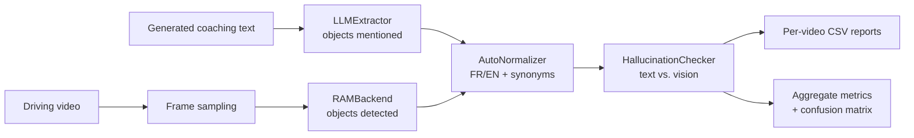
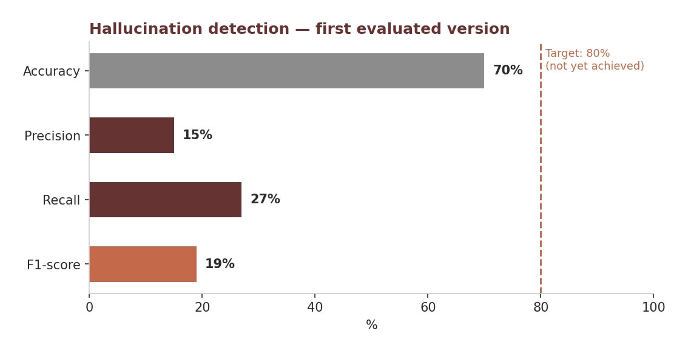

<a id="top"></a>

# Vision & LLM Evaluation Framework for Driving Scenarios

> An evaluation pipeline designed to identify hallucinated objects in AI-generated driving descriptions and coaching recommendations.

**[Overview](#overview)** · **[Pipeline](#pipeline)** · **[Data](#data)** · **[Metrics](#metrics)** · **[Results](#results)** · **[Limitations](#limitations)**

| | |
|---|---|
| **Problem** | AI-generated driving-coaching text may mention objects that are not visible in the video. |
| **Approach** | Designed an automated pipeline: extract objects from the text (LLM), detect objects in video frames (RAM), normalize both, compare. |
| **Key result** | First evaluated version: 70% accuracy, 15% precision, 27% recall on videos with ground-truth labels. |
| **Stack** | LLM · Recognize Anything Model (RAM) · Python · JSON · CSV |
| **Context** | Industrial project. Source code and data are confidential. |

## Overview

In driving-assistance and coaching applications, AI models analyze road scenes and generate recommendations such as *slow down, a pedestrian is crossing*. However, generated descriptions may mention objects that are not actually present in the scene.

This project evaluates the reliability of an internal driving-coaching model by comparing the objects mentioned in its generated text with the objects detected in the video frames. The pipeline flags potential hallucinations and produces quantitative evaluation results. It was designed to be robust, reproducible and scalable to larger video sets.

In this project, a **hallucination** is an object mentioned in the generated text that is not found among the objects detected in the sampled frames.

## Objectives

* Identify objects mentioned in AI-generated driving descriptions.
* Detect objects present in sampled video frames.
* Normalize object names and group synonyms across French and English.
* Compare textual descriptions with visual detections.
* Flag potential hallucinations.
* Generate per-video evaluation reports and aggregate metrics.

## Pipeline



1. **LLMExtractor** extracts the objects mentioned in the generated coaching text.
2. **RAMBackend** detects objects visible in video frames using the Recognize Anything Model (RAM).
3. **AutoNormalizer** harmonizes object names across French and English and groups synonyms.
4. **HallucinationChecker** compares the two sets of objects and flags discrepancies.
5. **Metrics** generates per-video reports and computes precision, recall, F1-score and the confusion matrix.

## Data

The evaluation uses driving-scene videos and their generated coaching descriptions. 86 of the 155 videos have ground-truth annotations indicating whether a hallucination is present. Two or three sampled frames per video serve as visual evidence.

<details>
<summary><b>Annotation format (illustrative)</b></summary>

```json
{
  "video_001.webm": {
    "context": "A cyclist is riding on the road, with a car approaching from behind.",
    "hallucination": "no"
  },
  "video_002.webm": {
    "context": "Two pedestrians are crossing at a crosswalk near a bus.",
    "hallucination": "yes"
  }
}
```

</details>

<details>
<summary><b>Frame structure</b></summary>

```text
video_001/
└── frame_001.jpg
video_002/
└── frame_001.jpg
```

</details>

Textual and visual outputs are normalized before comparison, because the same object may be described with different words or in different languages.

## Metrics

* **Accuracy**: proportion of correct predictions.
* **Precision**: proportion of predicted hallucinations that are actual hallucinations.
* **Recall**: proportion of actual hallucinations detected.
* **F1-score**: harmonic mean of precision and recall.
* **Confusion matrix**: breakdown of correct and incorrect predictions.

## Results



| Metric    | Result |
| --------- | -----: |
| Accuracy  |    70% |
| Precision |    15% |
| Recall    |    27% |
| F1-score  |    19% |

The pipeline correctly identifies videos **without** hallucinations, but does not yet reliably detect actual hallucinations. When accuracy is much higher than precision, class imbalance is a likely factor: most videos contain no hallucination, so a high accuracy alone says little.

### Example of per-video results

| Video | Predicted hallucination | Missing objects | Ground truth | Agreement |
| ----- | ----------------------- | --------------- | ------------ | --------- |
| 1_001 | False                   | none               | False        | True      |
| 1_005 | True                    | traffic_light   | True         | True      |

## Outputs

* Per-video CSV evaluation reports.
* Predicted hallucination labels.
* Object discrepancies identified during comparison.
* Aggregate evaluation metrics and confusion matrix.

## Technologies

| Category         | Technologies                              |
| ---------------- | ----------------------------------------- |
| Text analysis    | Large Language Model (object extraction)  |
| Vision           | Recognize Anything Model (RAM)            |
| Processing       | Python, multilingual normalization        |
| Data formats     | JSON (annotations), CSV (reports)         |
| Evaluation       | Precision, recall, F1-score, confusion matrix |

## Key Takeaways

* Designing a custom evaluation pipeline for an applied AI use case.
* Cross-checking information extracted from text against visual evidence.
* Handling multilingual normalization when comparing descriptions.
* Choosing metrics suited to an imbalanced detection problem.
* Using low precision and recall as a diagnostic to guide the next iteration.

## Limitations

* Precision and recall remain low in the evaluated configuration.
* French–English normalization and synonym grouping can be improved.
* The frame-sampling parameter (tested value: `k = 60`) influences the results; sparse sampling may miss objects visible at other moments.
* Ground-truth annotations are available for only 86 of the 155 videos.

## Future Improvements

* Make object extraction and normalization more robust.
* Test alternative frame-sampling parameters.
* Analyze false positives and false negatives individually.
* Unify the workflow: video folder + annotation JSON → CSV reports, aggregate metrics and confusion matrix.
* Target precision and recall above 80%.

## Author

**Rosette-Michèle Otounga**
Data & AI Engineer · Data Engineering · Applied AI

* [LinkedIn](https://linkedin.com/in/rosette-michele)
* [Portfolio](https://github.com/soley000/omr-portfolio)

<p align="right"><a href="#top">↑ Back to top</a></p>
