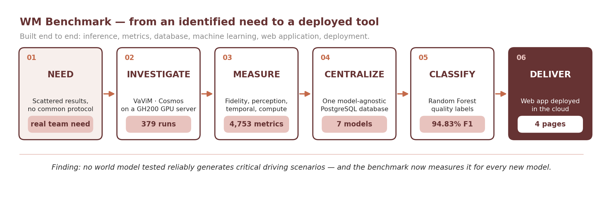
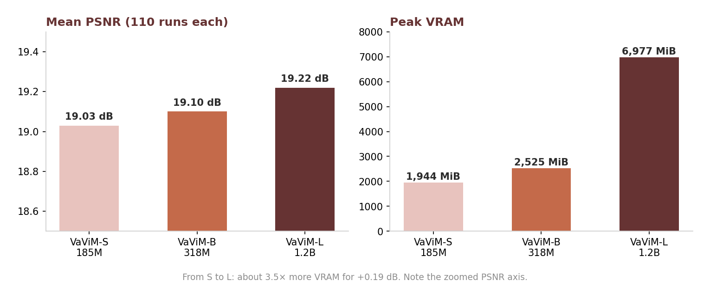
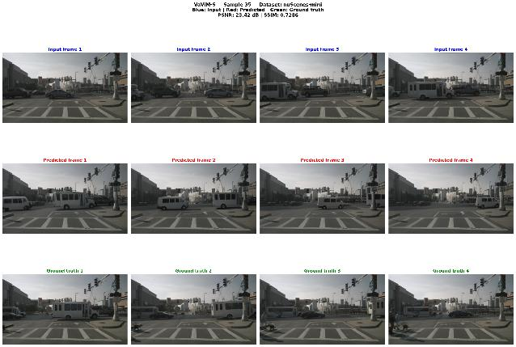
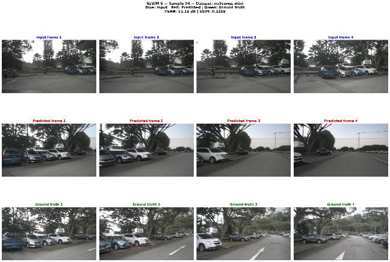
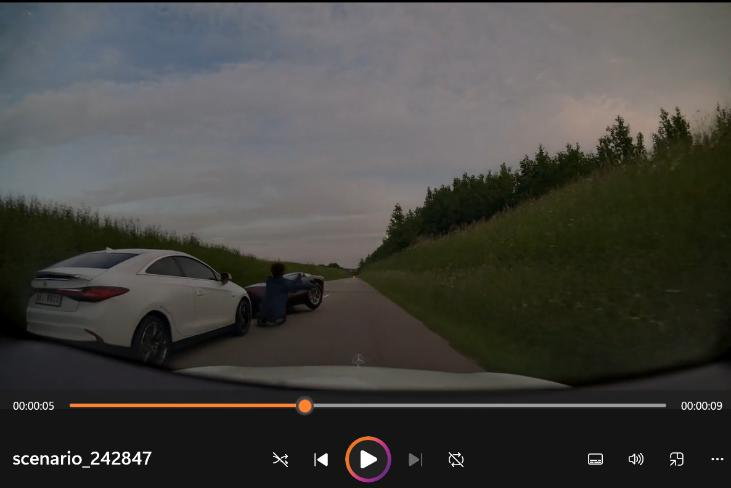
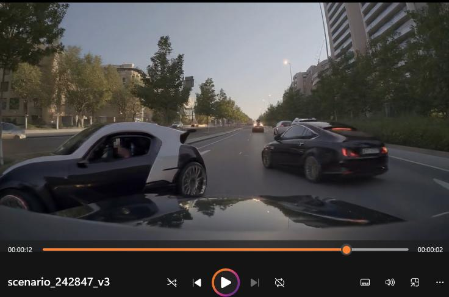
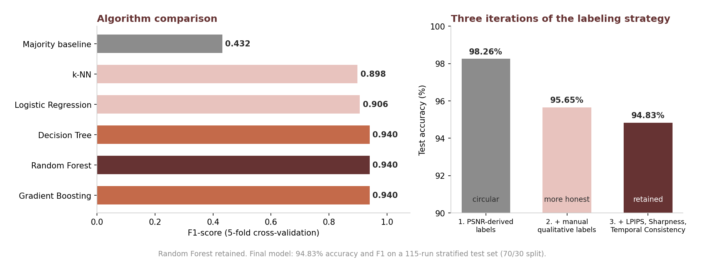
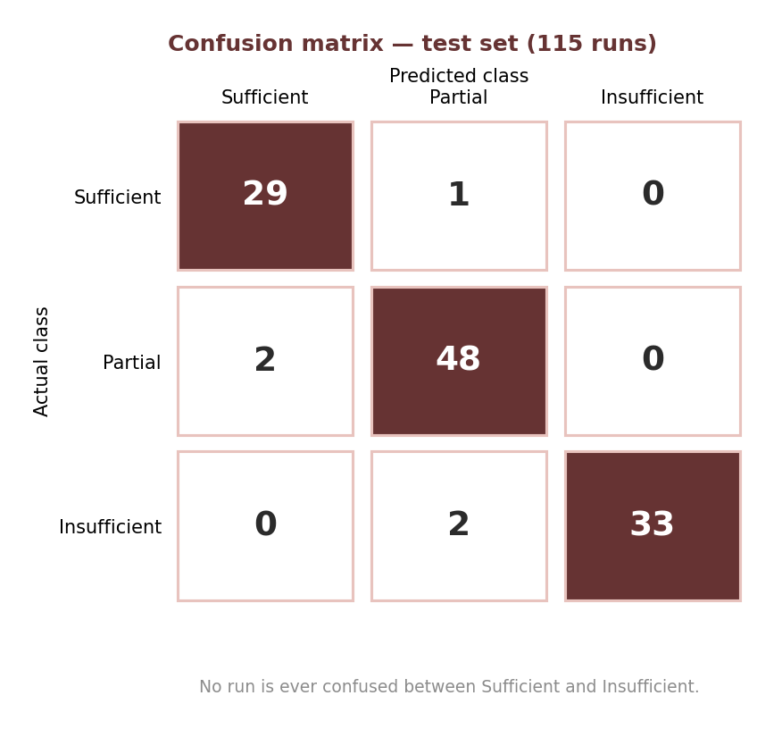
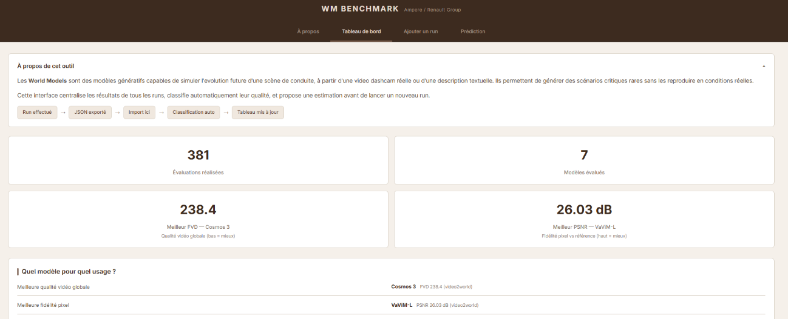
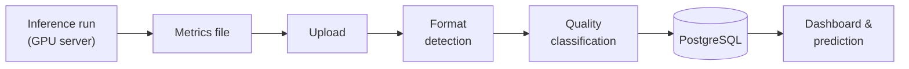

# WM Benchmark: Evaluating Generative World Models for Autonomous Driving

> An end-to-end benchmarking platform that turns scattered model evaluations into comparable results, automatic quality labels and fast decisions.

**[Live demo](#live-demo)** · **[Overview](#overview)** · **[Why this project](#why-this-project)** · **[Solution](#solution)** · **[End-to-end delivery](#end-to-end-delivery)** · **[Results](#results)** · **[Classification](#automatic-quality-classification)** · **[Application](#application)** · **[Limitations](#limitations)**

| | |
|---|---|
| **Problem** | World-model evaluations were run one by one, with no common protocol: results were useful once, then impossible to compare or to act on. |
| **Approach** | Designed and built, from inference to deployment, a model-agnostic benchmark: run models, measure them, centralize results, classify runs automatically, compare and decide in a web application. |
| **Key result** | 381 runs and 4,753 metrics centralized; quality classifier at 94.83% accuracy and F1; deployed application usable without technical skills. |
| **Stack** | Python · PyTorch · Docker · PostgreSQL · FastAPI · scikit-learn · HTML/CSS/JS |
| **Context** | Industrial project, professional thesis. Code and data are not published; a live demo is available on invitation. |

## Overview

A **world model** is an AI model that simulates how a driving scene will evolve, from a real dashcam video or a text description. For driver-assistance systems, its promise is to generate **rare and critical scenarios** (a pedestrian stepping out, sudden braking) on demand, without reproducing them on the road.

New world models appear constantly. Before choosing one, a team needs to answer simple questions quickly: *Is this model good enough? Better than the previous one? Worth the compute?* **WM Benchmark** was built to answer them: it benchmarks models in a common way, ranks their results, labels every run automatically and turns evaluation into decision.

## Why This Project

### The need

While investigating several world models, the same pattern repeated: test a model, note the results in a local file, move on to the next. Each investigation had its own scripts, its own metrics, its own file format. The observations were useful once, then **impossible to compare over time**, and no decision could be grounded on them.

This observation met a need expressed by the team's safety innovation lead. The problem was not a missing model. It was a **missing tool**.

| Before | After |
|---|---|
| Results scattered across local files | One central database |
| Different scripts and metrics per model | One common evaluation framework |
| No way to compare models over time | Side-by-side comparison in a dashboard |
| Every result read and judged manually | Automatic quality label for each run |
| Runs launched blind, at full compute cost | Quality and cost estimated before launching |

### From evaluation to decision

The value of a benchmark is the decisions it makes faster. Each question below used to require manual work; it now takes a few clicks.

| Decision to make | How WM Benchmark answers |
|---|---|
| Is this run usable? | Automatic quality label as soon as the results are uploaded |
| Which model for which use? | Dashboard ranking models by fidelity, quality or cost, with a "which model for which use" summary |
| Is a bigger model worth it? | Side-by-side fidelity versus GPU memory and duration |
| Is a new model better than the current ones? | Upload its metrics: it is compared immediately, with no code change |
| Is this run worth launching? | Predicted quality, duration and GPU memory before using any compute |

## Objectives

* Evaluate heterogeneous world models (specialized and generalist) within one common framework.
* Centralize every result in a single source of truth.
* Classify each run automatically into a clear quality level.
* Make comparisons and estimates accessible to non-technical team members.
* Support fast, documented and reproducible decisions on which models to pursue.

## Solution

A benchmarking platform designed around three principles:

* **Model-agnostic input**: any metrics file is accepted, whatever its structure. Adding a new model requires no code change.
* **One source of truth**: every metric from every model lands in the same database, enabling cross-model comparisons for the first time.
* **Automatic judgment**: a machine learning model labels each run as **sufficient**, **partial** or **insufficient** quality, instantly.

All of it is exposed through a web application, so any team member can upload, compare and anticipate results from a browser.

## End-to-End Delivery

The metrics and candidate models were framed with the team. Everything below was built individually, from the first inference to the deployed tool.

| Step | What was done | Skills |
|---|---|---|
| **1. Investigate** | Ran 379 inference runs on VaViM (3 sizes) and Cosmos Predict 2.5 (text-to-video and video prediction) on an ARM-based NVIDIA GH200 server, adapting the official Docker environments | Model inference, Docker, GPU environments |
| **2. Measure** | Computed fidelity, perceptual, sharpness and temporal-consistency metrics on hundreds of generated videos and frames | Computer vision, video metrics |
| **3. Centralize** | Designed a PostgreSQL schema able to store very different metrics for very different models, with duplicate-free ingestion | Data modeling, data engineering |
| **4. Classify** | Trained and validated a quality classifier, detecting and correcting a hidden bias along the way | Machine learning, evaluation rigor |
| **5. Deliver** | Built the API, the four-page interface and the cloud deployment | Backend, frontend, deployment |
| **Throughout** | Managed the project in two-week sprints; when cloud GPUs became unavailable, moved all experiments to an internal server without delaying the plan | Agile project management, problem solving |

Results from two additional models (Cosmos 3, WAN 2.2) were integrated from a colleague's aggregate metrics, which also proved that the platform absorbs a new format without code changes.

## Models Investigated

| Model | Organization | Mode | Runs |
|---|---|---|---|
| VaViM S / B / L | Valeo.ai | video prediction | 3 × 110 |
| Cosmos Predict 2.5 | NVIDIA | text-to-video | 30 |
| Cosmos Predict 2.5 | NVIDIA | video prediction | 19 |
| Cosmos 3 · WAN 2.2 | NVIDIA · Alibaba | video prediction | aggregate results |

The selection deliberately contrasts a **specialized** driving model (VaViM, trained on real driving data) with a **generalist** foundation model (Cosmos).

<b>Evaluated dimensions</b>

* Pixel and structural fidelity to the real future (PSNR, SSIM).
* Perceptual similarity (LPIPS).
* Image sharpness, without reference.
* Temporal consistency between consecutive frames.
* Overall video quality and trajectory plausibility (FVD, FTD).
* Compute cost: GPU memory and duration.
* Manual qualitative analysis for text-to-video outputs: hallucinations, fidelity to the scenario, presence of a critical situation.

## Results

### VaViM: good at continuity, poor at surprises

Moving from the Small to the Large model costs about 3.5× more GPU memory for a 0.19 dB gain: **bigger is not automatically better**, a decision the benchmark now makes visible. The best predictions come from smooth, straight-line scenes; the worst from intersections and sudden events.

| Good run: straight road | Poor run: intersection |
|:---:|:---:|
|  |  |

*Rows: input, prediction, ground truth. Source frames: nuScenes (CC BY-NC-SA 4.0).*

### Cosmos text-to-video: prompt engineering works, the safety bias remains

Ten critical driving scenarios were written in three successive prompt versions. Iterative prompt engineering reduced hallucinations from **10 of 10 scenarios to 1 of 10**. But across all 30 videos, **the model never generated a collision**: the situations most valuable for validation are precisely those it avoids.

| First prompt version | Final prompt version |
|:---:|:---:|
|  |  |

### Cosmos video prediction: smooth but wrong

All 19 runs were classified as insufficient on fidelity, yet their temporal consistency was higher than VaViM's. Cosmos produces visually smooth predictions that drift away from reality: **a single metric is not enough to judge a run**, which is exactly why the benchmark combines several.

### The answer to the original question

Specialized models beat generalist ones on fidelity; generalist models bring text-to-video generation that specialized ones lack. **No model tested reliably generates truly critical situations**, and the team can now measure this the same way for every new model.

## Automatic Quality Classification

An automatic label is only useful if it can be trusted to drive decisions. Six algorithms were compared in cross-validation; a **Random Forest** was retained for its robustness to missing metrics and its interpretability.

The first version scored **98.26%**, and that was the warning sign. The labels and the main feature came from the same metric: the model was reproducing a rule, not judging runs. Adding qualitative labels and independent metrics removed that circularity. **The final 94.83% is lower, and it is the one worth trusting.**

The result that matters most for decision-making: the classifier **never mistakes an insufficient run for a sufficient one**, so no decision rests on an error in the most dangerous direction.

## Application

| Page | Role |
|---|---|
| Dashboard | Key indicators, best scores, "which model for which use" summary, sortable comparison by model, filterable run details |
| Add a run | Drop a metrics file: its format is detected, the run is classified with a confidence score and stored without duplicates |
| Prediction | Estimate a run's likely quality, duration and GPU memory before launching it; for a model taking about 20 minutes per run, skipping a run predicted as insufficient saves compute directly |
| About | Explains world models, metrics and labels so a newcomer understands the tool in under two minutes |

### Live demo

**[Open the demo](https://wm-benchmark.onrender.com)**: the About page is public; the dashboard, run upload and prediction are available on invitation.

* The demo serves a fixed snapshot of the benchmark (7 models, 381 runs, 4,753 metrics). Runs added during a demo are discarded when the service restarts.
* The service runs on a free plan that sleeps when unused: the first page can take about one minute to load.

## Architecture

The application does not run the models, which require heavy GPU infrastructure: it handles everything after inference. The industrial version stores results in PostgreSQL; the public demo uses a SQLite copy of the same data, so it never expires and costs nothing. The backend serves both the API and the interface, and the classifier is loaded once at startup so that every answer comes back in milliseconds.

<b>Compliance</b>

* **GDPR**: no personal data collected or stored, no user accounts, no tracking; the demo's access password and credentials are kept out of version control.
* **EU AI Act**: internal decision-support tool, no autonomous decision about people; minimal risk.
* **Accessibility**: large text, WCAG AAA contrast, keyboard navigation.
* **Licenses**: datasets and models used under their respective licenses (nuScenes CC BY-NC-SA 4.0, VaViM MIT/RAIL, Cosmos NVIDIA Open Model License).

## Technologies

| Category | Technologies |
|---|---|
| Inference | PyTorch, Docker, NVIDIA GH200 (ARM) |
| Video metrics | LPIPS, OpenCV, scikit-image, NumPy |
| Data | PostgreSQL (SQLite for the public demo) |
| Machine Learning | scikit-learn, pandas |
| Backend | Python, FastAPI |
| Frontend | HTML, CSS, JavaScript |
| Deployment | Cloud hosting with automatic deployment from GitHub |
| Project management | Scrum, two-week sprints |

## Key Takeaways

* A benchmark is worth the decisions it makes faster: centralizing and classifying results turns evaluation into action.
* Building the tool end to end, from GPU inference to a deployed application, is what makes it usable by the whole team.
* A high score can be circular: label construction must be checked as carefully as the model.
* Temporal smoothness and fidelity to reality are different things; a single metric misleads.
* Prompt engineering can remove hallucinations, but not a bias built into the model.

## Limitations

* No model tested reliably generates critical long-tail scenarios: the original goal remains open.
* Two models are integrated through provided aggregate results, not reproduced.
* The evaluation set does not represent European driving conditions.
* Labels remain partly derived from metrics; independent human annotation would be preferable.

## Future Improvements

* Re-evaluate all models on a benchmark designed for generative world models (DrivingGen).
* Add new models and controllability metrics.
* Enrich the classifier as new models enter the benchmark.
* Trigger the benchmark automatically whenever a new model is published.

## Author

**Rosette-Michèle Otounga**
Data & AI Engineer · Data Engineering · Applied AI

* [LinkedIn](https://linkedin.com/in/rosette-michele)
* [Portfolio](https://github.com/soley000/omr-portfolio)

<a href="#top">↑ Back to top</a>

