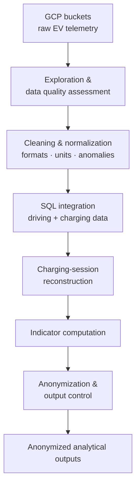
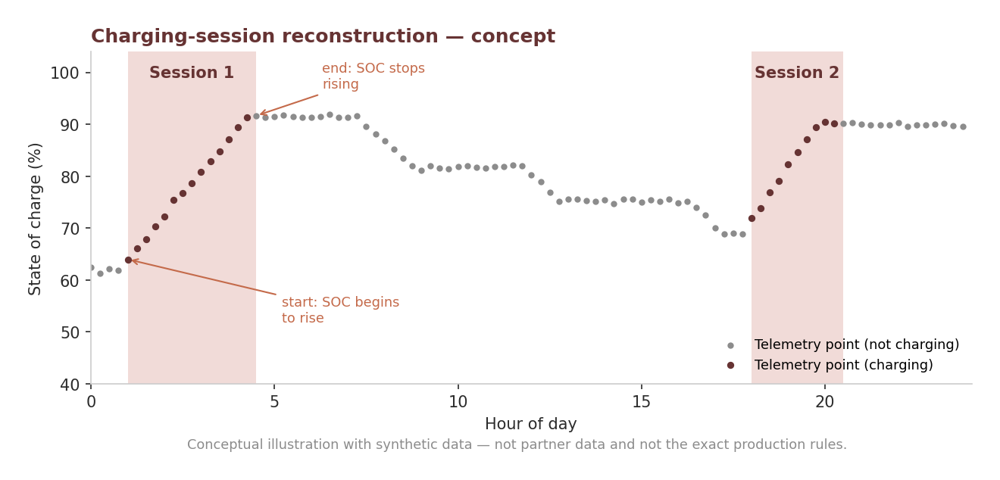

# EV Charging Data Engineering for Grid Regulation

> Transforming raw electric vehicle charging and driving data into structured, anonymized indicators for energy analysis.

**[Overview](#overview)** · **[Constraints](#constraints)** · **[Pipeline](#pipeline)** · **[Sessions](#session-reconstruction)** · **[Indicators](#indicators)** · **[Limitations](#limitations)**

| | |
|---|---|
| **Problem** | Raw EV telemetry cannot directly answer an energy partner's questions about charging behavior and its grid implications. |
| **Approach** | Assessed data quality, cleaned and normalized the data, cross-joined driving and charging tables in SQL to reconstruct sessions, translated business questions into indicators. |
| **Key result** | Complete, verified charging sessions and anonymized indicators delivered to an energy-sector partner. |
| **Stack** | Google Cloud Platform · SQL |
| **Context** | Industrial project with an energy-sector partner. Code and data are confidential. |

## Overview

Electric vehicle charging data can help characterize charging behavior, energy consumption and potential implications for electricity-grid management.

This industrial project transformed raw EV telemetry into structured, anonymized analytical indicators in collaboration with an energy-sector partner. The core of the work was to **translate the partner's business questions into measurable indicators**: exploring raw tables, assessing data quality, standardizing fields, combining driving and charging information, reconstructing charging sessions and computing the requested metrics.

## Objectives

* Explore raw charging and driving data and assess its quality.
* Clean anomalies and normalize formats and units.
* Combine data sources to reconstruct complete charging sessions.
* Compute energy and charging indicators.
* Identify long trips, high-consumption batteries and charging-session characteristics.
* Deliver anonymized analytical data for further energy analysis.

## Constraints

* Full anonymization of the data.
* Aggregated data only.
* No information allowing a user or a vehicle to be identified.
* Strict compliance with confidentiality rules and the GDPR.

## Data

Raw EV telemetry stored in Google Cloud Platform (GCP) buckets, covering charging and driving information: timestamps, anonymized vehicle identifiers, initial and final state of charge (SOC), charging power.

Illustrative example (not actual partner data):

| Timestamp        | Vehicle ID (anonymized) | SOC start (%) | SOC end (%) | Power (kW) |
| ---------------- | ----------------------- | ------------: | ----------: | ---------: |
| 2025-06-01 08:00 | VE_001_hash             |            20 |          80 |         22 |
| 2025-06-01 09:00 | VE_002_hash             |            50 |          90 |         11 |

## Pipeline

<b>Pipeline steps in detail</b>

1. **Raw data exploration**: inspect source tables to identify which columns and values can be used.
2. **Data quality assessment**: check consistency, missing values and duplicates.
3. **Cleaning and normalization**: correct anomalies and harmonize formats and units.
4. **Cross-table integration**: combine driving and charging records with SQL.
5. **Session reconstruction**: identify and rebuild complete charging sessions.
6. **Indicator computation**: translate business requests into clear figures.
7. **Anonymization and output control**: deliver only the data requested, with no identifiable user or vehicle information.

## Session Reconstruction

A charging session is reconstructed by combining related telemetry records into a single event with a start, an end and associated measurements (SOC variation, duration, power).

*Conceptual illustration with synthetic data. It shows the principle, not partner data or the exact production rules.*

## Indicators

| Business question | Indicator |
| ----------------- | --------- |
| On which days or periods do long or short trips occur? | Trip counts by day and period |
| Which vehicle types make the most energy-intensive trips? | Energy consumed by vehicle category |
| Which batteries consume the most, or lose SOC quickly? | SOC variation, high-consumption flags |
| How many charging sessions can be reconstructed completely? | Count of complete, verified sessions |
| What are the characteristics of charging sessions? | Duration, average and maximum power (kW) |

Business metrics are defined with explicit thresholds agreed with the partner, for example a long trip as more than *X* km or *Y* minutes, or a high-consumption battery as one exceeding a consumption threshold.

## Outputs

* Cleaned and standardized analytical data.
* Reconstructed and verified charging sessions.
* Anonymized, aggregated charging and driving indicators.
* Summaries of session duration, power and SOC variation.
* Analysis of long trips, long charging sessions and high-consumption cases, supporting the partner's forecasting and strategic analysis.

## Technologies

| Category          | Technologies                                |
| ----------------- | ------------------------------------------- |
| Cloud             | Google Cloud Platform (storage buckets)     |
| Data integration  | SQL (cross-table joins)                     |
| Data preparation  | Cleaning, normalization, quality assessment |
| Privacy           | Anonymization, aggregation, GDPR compliance |

## Key Takeaways

* Working with industrial telemetry from multiple related sources.
* Translating business questions into data transformations and measurable indicators.
* Using SQL to integrate data and reconstruct complete charging sessions.
* Assessing data quality before producing analytical outputs.
* Designing outputs under strict confidentiality and privacy constraints.

## Limitations

* Scope is defined by the available data and the indicators requested by the partner.
* Session-reconstruction quality depends on source-data completeness and consistency.
* Some indicators depend on business thresholds and definitions.
* Confidentiality prevents publishing raw data and detailed implementation.

## Future Improvements

* Automate recurring data quality checks.
* Strengthen validation of reconstructed charging sessions.
* Document indicator definitions and thresholds more comprehensively.
* Extend the indicator set based on additional business requirements.

## Author

**Rosette-Michèle Otounga**
Data & AI Engineer · Data Engineering · Applied AI

* [LinkedIn](https://linkedin.com/in/rosette-michele)
* [Portfolio](https://github.com/soley000/omr-portfolio)

<a href="#top">↑ Back to top</a>
