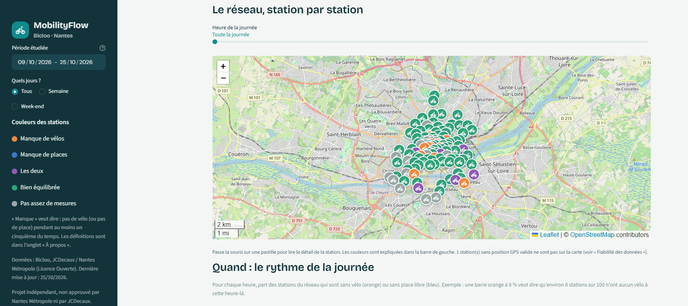
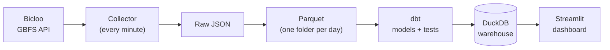
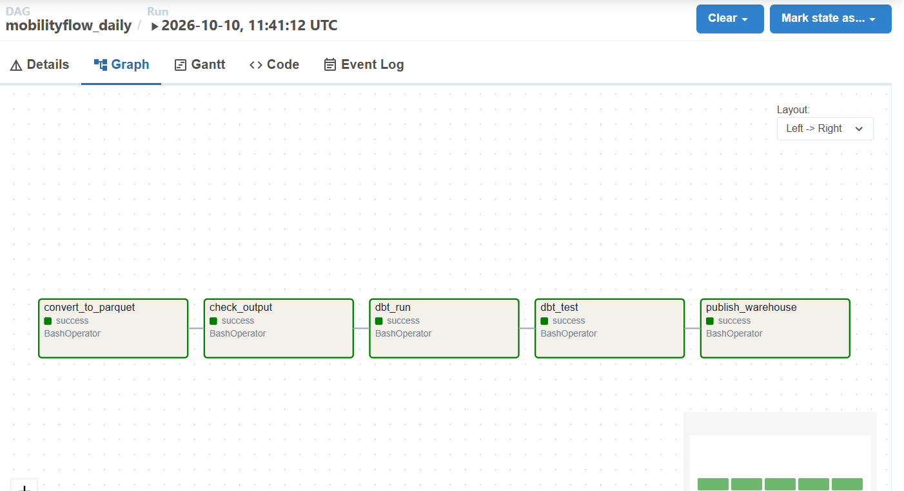
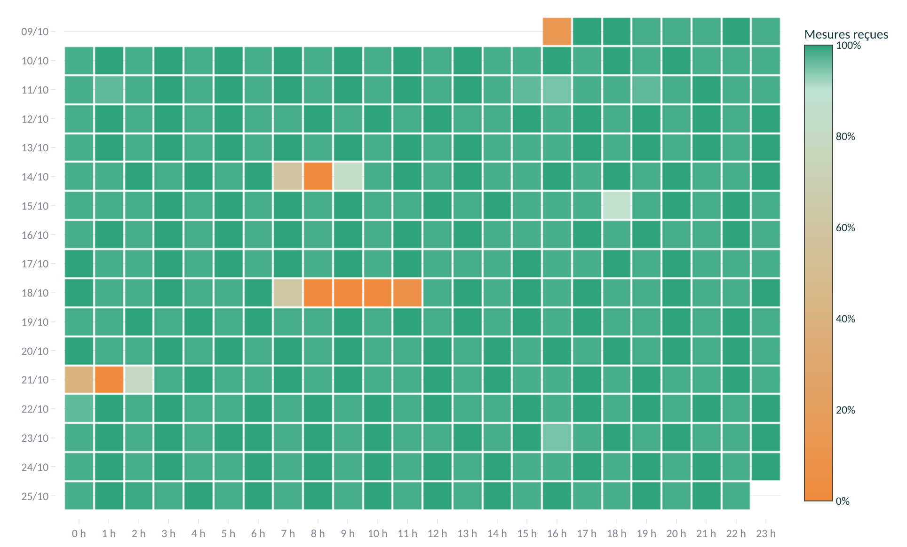
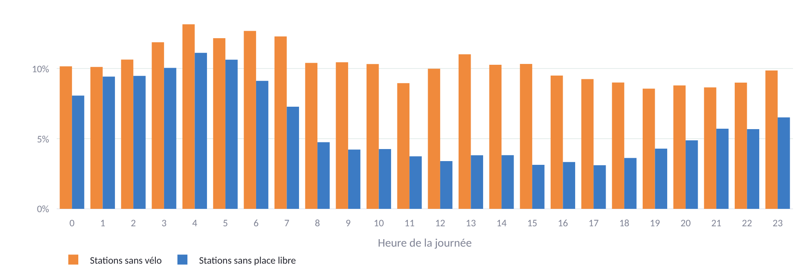

<a id="top"></a>

# MobilityFlow: Bike-Sharing Station Availability Platform

> An end-to-end data platform that turns a raw real-time bike-sharing feed into tested, decision-ready tables and a dashboard.

**[Overview](#overview)** · **[Architecture](#architecture)** · **[Data Pipeline](#data-pipeline)** · **[Data Quality](#data-quality)** · **[Results](#results)** · **[Dashboard](#dashboard)** · **[Installation](#installation)** · **[Limitations](#limitations)**

| | |
|---|---|
| **Problem** | The public bike-sharing feed shows only the current state of each station, keeps no history and contains unreliable records: an operations team cannot tell which stations lack bikes or docks, and when. |
| **Approach** | Collected the feed every minute, converted it to Parquet, built tested analytical tables with dbt in DuckDB, scheduled the chain with Airflow in Docker, and presented the answers in a Streamlit dashboard. |
| **Key result** | 2.67 million station measurements collected from 9 to 25 October 2026 (121 stations listed), about 97 % of the expected snapshots received. A nightly five-task pipeline with 26 dbt tests (24 pass, 2 documented warnings) and 20 automated tests in CI. Source data issues are detected, documented and shown in the dashboard instead of hidden. |
| **Stack** | Python · Parquet · Airflow · dbt · DuckDB · Docker · Streamlit |
| **Context** | Open source |



## Overview

Bike-sharing feeds only expose the current state of each station. They keep no history, and they include stations that are closed or not installed, as well as values that cannot be trusted. The questions an operations team cares about stay unanswered:

* Which stations are often empty (no bike to take) or full (no dock to return a bike), and at what time of day?
* Where should bikes be moved, and which stations should be checked?
* Can the figures be trusted, and has the collection itself missed anything?

**MobilityFlow** collects the Bicloo feed (Nantes, France) continuously, builds the missing history and turns it into reliable tables and a dashboard that answers these questions.

## Objectives

* Collect the feed continuously and keep a complete, timestamped history.
* Clean and model the data into analytical tables with automated quality checks.
* Answer the operations questions in plain language, in a dashboard.
* Make data issues visible: gaps in the collection, suspicious stations, unreliable fields.
* Keep the whole project local, free and reproducible.

## Dataset

| | |
|---|---|
| Source | Bicloo / Naolib network, Nantes Métropole, operated by JCDecaux (GBFS 2.3) |
| Entry point | `https://api.cyclocity.fr/contracts/nantes/gbfs/gbfs.json` |
| Feeds used | `station_status` (every minute), `station_information` (refreshed every 6 hours), `system_information` (at start) |
| Size | 121 stations listed (107 at the start), one snapshot per minute, 2.67 million station measurements in total |
| History | Collected by this project from 9 to 25 October 2026 (the source keeps none) |
| Licence | Licence Ouverte (Etalab): version 1.0 on the JCDecaux developer site, version 2.0 in the national catalogue. Both require crediting the producer and the date of the last update (see Attribution). |

## Architecture



Airflow runs the chain from the Parquet conversion to the published warehouse every night at 03:00 (Paris time), for the previous day. The dashboard only reads the published warehouse, in read-only mode.

A production setup would add a message queue (Kafka) and a stream-processing branch (PySpark) in front of a cloud warehouse (BigQuery). That direction is described here only. It is not built: the volume does not require it, and the project is meant to stay free and reproducible.

## Data Pipeline



<details>
<summary><b>The five Airflow tasks (DAG <code>mobilityflow_daily</code>)</b></summary>

| Task | What it does |
|---|---|
| `convert_to_parquet` | Turns the raw JSON files of one Paris day into Parquet. Can be re-run for any day. |
| `check_output` | Checks that the day's Parquet file exists and is not empty. |
| `dbt_run` | Rebuilds the analytical tables in a database local to the container. |
| `dbt_test` | Runs the data tests. A test in error fails the task; a warning does not block. |
| `publish_warehouse` | Copies the finished database to the shared data folder with an atomic replace. |

The database is built inside the container and then copied. DuckDB locks its file, and a Windows folder mounted in Docker can make that lock fail. Replacing the file in one step also means the dashboard never reads a half-written database, and a failed test leaves the previous database in place.

Each run processes the previous day. A manual run can target any day with `{"date": "YYYY-MM-DD"}`.

</details>

<details>
<summary><b>The dbt models</b></summary>

| Layer | Model | Content |
|---|---|---|
| Staging | `stg_station_status`, `stg_station_information` | Typed, cleaned tables built from the Parquet files (latest reference data per station) |
| Mart | `dim_station` | One row per station: position, declared and observed capacity, capacity gap flag, in service now |
| Mart | `fct_station_hour` | Per station and hour: bikes (average, minimum, maximum), share of time empty or full, fill rate |
| Mart | `fct_collection_hourly` | Per hour of the period, including hours with no snapshot at all: snapshots received versus expected, to detect collection gaps |
| Mart | `fct_station_unchanged` | Longest and current period without any change, to flag stations that look frozen |

Tests cover uniqueness, value ranges, negative counts, duplicate snapshots, capacity consistency and valid coordinates. Known issues of the source are set to warnings on purpose, so they stay visible without blocking the pipeline.

</details>

## Data Quality

The raw feed cannot be used as it is. Each issue below was measured, then turned into a rule or a visible flag.

<details>
<summary><b>What the feed showed, and what was decided</b></summary>

| Finding | How it was established | Decision |
|---|---|---|
| `last_reported` does not measure freshness: 887 of 892 bike-count changes happened without it moving, and 96 of 107 stations never saw it change. | 100 consecutive snapshots | Kept in the Parquet files for information, used in no quality rule. |
| Some stations are not installed or closed for rental. At the last measurement, 71 of the 121 listed stations are in service. | Station status at the last snapshot | Excluded from availability statistics and flagged. |
| For some stations, capacity does not match the sum of available and out-of-service bikes and docks, always by the same amount: 5 stations at the first check, 12 in the final data. | 152 snapshots, then the full period | Declared and observed capacity are both kept, the gap is flagged, and fill rates use the observed value. The cause is not verified. |
| One station is reported at coordinates (0, 0). | Dashboard map check | Left out of the map, kept in the calculations, listed in the dashboard and covered by a dbt warning test. |
| Five collection gaps, from 8 to 199 missing snapshots, plus about one snapshot lost every two hours by the collector's timing loop. About 97 % of the expected snapshots were received. | Hour-by-hour completeness table | Shown as gaps in the dashboard, not filled in. |
| The first completeness table only listed hours that had data, so an hour with no snapshot at all did not appear. | Comparison with the raw files | The model now starts from the full list of hours of the period, and empty hours show 0 received. |
| On 25 October, the clock change makes the day last 25 hours: one local hour occurs twice and holds 120 snapshots. | A dbt warning on that day | Expected snapshots are counted per hour, 120 for the repeated hour, and the test compares with that value. |
| The number of stations in service per minute fell from about 102 to about 68 after 19 October, when the rollout of VOI e-bikes started in Nantes. | Daily count of stations seen and in service | Documented as a network change. The link between the two is a hypothesis, as the source does not state a cause. |

A station that looks frozen cannot be told apart with certainty from a station that is simply quiet. The dashboard says so.

</details>

## Results

| Measure | Value |
|---|---|
| Period | 9 to 25 October 2026 |
| Stations listed | 121 (107 at the start), 71 in service at the last measurement |
| Station measurements | 2.67 million |
| Snapshots received | about 97 % of those expected |
| dbt tests | 26: 24 pass, 2 warnings explained (capacity gaps, coordinates at (0, 0)) |
| Automated tests in CI | 20, green on GitHub Actions |

**The 20 % rule is stable.** A station is described as lacking bikes or docks when it is empty (or full) for at least 20 % of its in-service measurements. The number of stations flagged at each threshold, on the full period and on the stable period before the network change:

| Threshold | 9 to 25 October | 9 to 18 October |
|---|---|---|
| 10 % | 56 | 56 |
| 15 % | 33 | 36 |
| **20 %** | **19** | **22** |
| 25 % | 15 | 13 |
| 30 % | 10 | 11 |
| 40 % | 5 | 5 |

At 20 %, about twenty stations are flagged on either period, and many more stations are often empty than often full. The choice is a design decision, kept because the result does not depend on the network change.

**The frozen-station threshold was raised from 6 to 24 hours.** At 6 hours, 90 of the 102 stations with data were flagged, because most stations are quiet for a night. At 24 hours, 7 stations had at least one such period, 4 reached 36 hours and 2 reached 48 hours, and none was frozen at the last measurement. A flagged station is a signal, not a diagnosis.



## Dashboard

Four pages, written in plain language, reading the warehouse in read-only mode. The dashboard opens on the "When and where" page.

| Page | Role |
|---|---|
| When and where | Map of stations coloured by verdict, hourly profile, top stations, heatmap by hour |
| Summary | Where to send bikes, what to check, and whether the figures can be trusted |
| Data reliability | Collection gaps, capacity gaps, stations without valid coordinates, stations that look frozen |
| About | The problem, the pipeline, a short glossary and the limits |



## Technologies

| Category | Technologies |
|---|---|
| Language | Python 3.10+ |
| Collection | Python standard library (HTTP, JSON) |
| Storage | Parquet, DuckDB |
| Orchestration | Airflow 2.10 (standalone mode) |
| Transformation and tests | dbt (dbt-duckdb) |
| Environment | Docker, Docker Compose |
| Quality | pytest, GitHub Actions |
| Dashboard | Streamlit, Plotly, Folium |

<details>
<summary><b>Why these tools, and the simpler alternative</b></summary>

| Tool | Why here | Simpler alternative |
|---|---|---|
| Parquet | Compact columnar files, fast to read, one folder per day | JSON or CSV |
| Airflow | Scheduling, retries, visible task status, re-run of a given day | cron |
| dbt | Versioned models and data tests next to the SQL | Plain SQL scripts |
| DuckDB | Free, local, no account, one file | BigQuery sandbox (tables expire after 60 days) |
| Docker | Same environment for everyone, Airflow and dbt isolated from the host | Local installs |
| Streamlit | A dashboard in Python, close to the data | A BI tool |

</details>

## Installation

Requires Docker Desktop and Python 3.10+. Commands are for Windows PowerShell.

1. Start the collector and keep it running (one line per minute):

```powershell
python ingestion\collector.py --out C:\dev\mobilityflow-data
```

2. Start Airflow. The data folder defaults to `C:/dev/mobilityflow-data` and can be changed with `MOBILITYFLOW_DATA_DIR`:

```powershell
docker compose up -d --build
```

The interface is at `http://localhost:8080`, and the login is printed in the container logs at first start. The DAG runs every night at 03:00 and processes the previous day.

3. Start the dashboard:

```powershell
python -m pip install -r app\requirements.txt
python -m streamlit run app\streamlit_app.py
```

Raw file names use UTC time. Days are cut on Paris time.

<details>
<summary><b>Project structure</b></summary>

```text
real-time-mobility-data-platform/
├── ingestion/            # raw collector
├── pipeline/             # JSON to Parquet conversion, output check and frozen export
├── dags/                 # Airflow DAG and failure alert
├── monitoring/           # health check (collector, collection, warehouse, failures)
├── tests/                # automated tests on generated data
├── dbt/                  # models, tests and macros
├── app/                  # Streamlit dashboard
├── export/               # frozen export read by the public demo
├── exploration/          # data exploration scripts
├── docs/                 # notes and decisions
├── .streamlit/           # dashboard theme
├── docker-compose.yml
├── Dockerfile
├── .gitignore
└── README.md
```

</details>

## Evaluation

* The scripts and dbt models were tested on generated data covering several days, with deliberate issues: gaps, frozen stations and a station at (0, 0).
* These tests run automatically on every change through GitHub Actions (JSON to Parquet, dbt run and test, dashboard data access, health check) and check that each planted issue is detected.
* The full chain (five Airflow tasks, publication of the warehouse, reading by the dashboard) ran on the real collected data, and the final warehouse passes 24 dbt tests with 2 documented warnings.
* The 20 % rule was tested from 10 % to 40 % on two periods, and the frozen-station threshold was measured at 6, 8, 12, 18, 24, 36 and 48 hours before being fixed.
* A weakness found on the real data was fixed: hours with no snapshot at all were missing from the completeness table.

## Deployment and Monitoring

* The pipeline runs locally in Docker. A frozen, public version of the dashboard, built from the final export (`pipeline/export_frozen.py`, 1.8 MB), is hosted for free on Streamlit Community Cloud.
* Data quality is monitored through the dbt tests, the output check and the dashboard's reliability page.
* Pipeline failures are visible in the Airflow interface and written to an alert log (`monitoring/failures.log` in the data folder).
* A health check (`monitoring/health_check.py`) reports whether the collector is alive, the last hour of collection is complete, the warehouse is up to date and no task has failed. There is no push notification.

Cost: 0 EUR. No cloud billing account is attached.

## Key Takeaways

* A feed can look complete and still be unreliable: only a collected history revealed that `last_reported` does not track freshness.
* Showing data issues is part of the product: the dashboard states gaps, capacity mismatches and invalid coordinates instead of hiding them.
* Monitoring the collection itself matters as much as monitoring the source: a completeness table that lists only existing hours hides the worst gaps.
* A threshold should be measured before it is fixed: the frozen-station rule at 6 hours flagged most of the network, and at 24 hours it separates quiet nights from stations that stay unchanged for a day or more.
* Building the database apart and replacing it in one step keeps the dashboard safe from half-written files and from failed runs.
* The right tool depends on the volume: at this scale, streaming tools would add complexity without answering the business questions.

## Limitations

* One network (Nantes). The history covers 9 to 25 October 2026 and is frozen: the collection stopped and the dashboard is not live.
* The network changed during the collection: the rollout of VOI e-bikes started on 19 October 2026, and the number of stations in service fell from about 102 to about 68 per day on average. Averages over the full period mix both situations, and the cause is a hypothesis.
* The collector runs on a personal computer. Five gaps happened when it was off, and its timing loop loses about one snapshot every two hours. About 97 % of the expected snapshots were received.
* Airflow runs in `standalone` mode with SQLite and the sequential executor: a learning setup, not a production one.
* A frozen station cannot be told apart with certainty from a quiet one.
* The cause of the capacity gaps (12 stations) and of the (0, 0) coordinates is not verified.
* The `last_reported` field cannot be used to measure freshness.

## Future Improvements

* Add push notifications (email or chat) for pipeline failures and health-check results.
* Fix the collector's timing loop so that no snapshot is lost between two requests.
* Compare the network before and after the VOI rollout with a longer history.
* Reuse the history for failure prediction and for a natural-language analyst.

## Attribution

Data: Bicloo / Naolib network, Nantes Métropole, operated by JCDecaux, under Licence Ouverte (Etalab). Source: https://api.cyclocity.fr/contracts/nantes/gbfs/gbfs.json. The date of the last update (25 October 2026) is shown in the dashboard. This project is independent and is not approved or endorsed by Nantes Métropole or JCDecaux.

## Author

**Rosette-Michèle Otounga**
Data & AI Engineer · Data Engineering · Applied AI

* [LinkedIn](https://linkedin.com/in/rosette-michele)
* [Portfolio](https://github.com/soley000/omr-portfolio)

<p align="right"><a href="#top">↑ Back to top</a></p>
