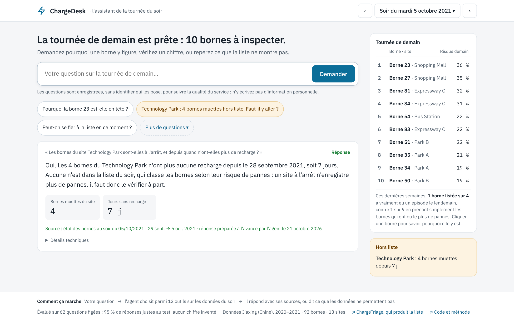
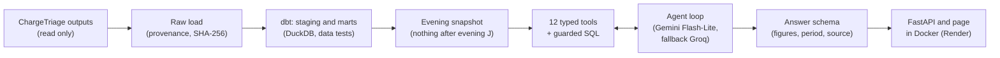
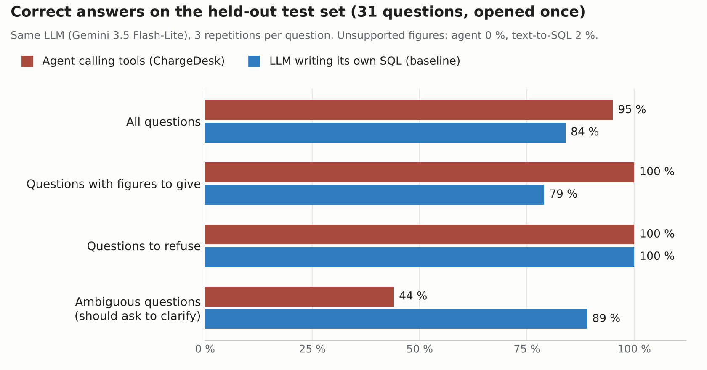

<a id="top"></a>

# ChargeDesk: an Evening Assistant for EV Charging Operators

> An LLM agent that answers an EV charging operator's evening questions in French, using controlled tools over the outputs of ChargeTriage: sourced figures, honest refusals, and a request for clarification when the question is ambiguous. Evaluated like a model.

**[Live demo](https://chargedesk.onrender.com)** · **[Overview](#overview)** · **[Architecture](#architecture)** · **[Method](#method)** · **[Results](#results)** · **[Product](#product)** · **[Deployment](#deployment-and-monitoring)** · **[Installation](#installation)** · **[Limitations](#limitations)**

| | |
|---|---|
| **Problem** | Each evening, the operator receives the list of 10 charging stations to inspect the next day ([ChargeTriage](../../ml-mlops/ev-charging-reliability/)). The list does not say why a station is on it, hides alerts outside the list (stations that stopped charging), and the figures cannot be checked without writing SQL. |
| **Approach** | A data warehouse built with dbt, an "evening snapshot" that hides everything after the evening in question, 12 typed tools, an agent loop with SQL guardrails, and a frozen set of 62 questions with expected answers, compared against two baselines, with a decision rule fixed in advance and a test set opened once. |
| **Key result** | On the held-out test set, the agent answered 95 % of questions correctly, against 84 % for the same LLM writing its own SQL, with 100 % on questions that require figures and no unsupported figure. The gain (+10.8 points) is not statistically established with 31 questions, and the agent asked for clarification too rarely: both are reported as such. |
| **Stack** | Python · DuckDB · dbt · Pydantic · sqlglot · Gemini 3.5 Flash-Lite · Groq (gpt-oss-120b) · FastAPI · Docker · GitHub Actions · Render |
| **Context** | Open source |

## Overview

A ranked list is only useful if the people who act on it understand it and trust it. The operator has two questions every evening:

* **Where do I send the team tomorrow?** The list, plus what the list does not show.
* **Can I trust it?** Why a station is ranked first, and whether a figure is right.

**ChargeDesk** puts an assistant at the centre of that evening review. The operator asks in French ("Pourquoi la borne 23 est-elle en tête ?", "Combien de pannes au Shopping Mall cette semaine ?"), and every answer gives its figures, the period and the source. Questions the data cannot answer (causes of faults, the future, costs, repairs) are refused, and vague questions ("the worst station") get a request for clarification instead of a guess.

**Live demo:** [chargedesk.onrender.com](https://chargedesk.onrender.com) covers the evenings of 31 August to 30 December 2021. Eight evenings have answers prepared in advance by the agent and served instantly; any other question is answered live. The service runs on free plans: the first page can take about one minute to wake up, and a live answer usually takes 2 to 8 seconds.



*Mock-up of the evening of 5 October 2021, rendered from the page's own code with illustrative values for part of the list; the live demo shows the exact figures.*

## Data

| | |
|---|---|
| Source | Outputs of [ChargeTriage](../../ml-mlops/ev-charging-reliability/): daily station metrics, features, the evening lists of the champion model and of the fallback rule over four months of simulated production, silent-station alerts and monthly drift |
| Original dataset | Zhang et al. (2025), *Scientific Data*, doi:10.6084/m9.figshare.28182251.v3: 441,060 charging sessions from 92 charging posts on 13 sites in Jiaxing (China) |
| Licence | CC BY 4.0 |

The data are not stored in this repository.

## Architecture



The LLM never sees the database directly. It chooses tools; each tool validates its arguments, queries the evening snapshot and returns figures with their source. The final answer must follow a schema, and the evaluation checks that every figure in it comes from a tool result.

## Method

<details>
<summary><b>1. A warehouse that cannot leak the future</b></summary>

An assistant asked on evening J must not know what happened on day J+1. Three forms of leakage were found and closed while building the warehouse:

* the next-day outcome, stored in the same rows as the evening features;
* a dimension table holding dated columns (last charge, totals over the whole period), now restricted to fixed attributes and protected by a test;
* the training table of ChargeTriage, whose rows exist only when the next day is observable: its mere presence reveals the future. It was replaced, for the agent, by a table with one row per station and evening, checked against ChargeTriage on the 56,673 common rows.

All tools read through an **evening snapshot** that exposes only what was known on the evening of the question. This rule is enforced by code and tests, not by the prompt.

</details>

<details>
<summary><b>2. A frozen evaluation set, written before any agent code</b></summary>

62 questions in French, in 10 categories (facts, comparisons, lists, alerts, list reliability, ambiguous questions, causal questions, the future, out-of-data questions, requests to modify data). Each expected figure is computed by its own SQL query on the warehouse as seen from the evening of the question.

| Split | Evenings | Questions |
|---|---|---|
| Development | September and October 2021 | 31 |
| Test, opened once | November and December 2021 | 31 |

The set was frozen on 15 October 2026 (SHA-256 checked by a test). Grading rules were written first: exact counts, rates within 0.001, scores within 0.005, energy within 0.5 %, and **supported figures** (every figure in an answer must appear in a tool result).

</details>

<details>
<summary><b>3. Two baselines and four candidate models</b></summary>

* **No tools**: the LLM answers from the question alone. It refuses correctly but gives no figures (about 30 % correct).
* **Text-to-SQL**: the LLM writes its own SQL, checked by a guard (read only, allowed tables, one statement, row limit). This is the score to beat.

Four free-tier LLMs were compared on correctness, latency and quotas. Gemma 4 31B was slightly more accurate as a text-to-SQL engine but took 2 to 9 minutes per question; Gemini 3.8 Flash allowed only 20 requests per day. **Gemini 3.5 Flash-Lite** became the champion and **Groq gpt-oss-120b** the fallback (faster, but a small daily quota).

</details>

<details>
<summary><b>4. The agent</b></summary>

* 12 tools with arguments validated by Pydantic: metrics by period and site, period comparisons, the evening list, the signals behind a station's score, champion against fallback lists, station status, silent alerts, list reliability, list hits, station rankings, drift, and a guarded SQL tool as a last resort.
* A loop of at most 6 steps, temperature 0, no agent framework.
* Tool errors (invalid argument, rejected or failing SQL) are sent back to the LLM, which corrects itself at the next step; a failing SQL query returns the list of allowed columns.
* One OpenAI-compatible client for both providers, with a disk cache, per-minute rate limits, quota handling and adjustable patience.

</details>

<details>
<summary><b>5. A decision rule fixed in advance</b></summary>

The agent had to meet all four conditions against text-to-SQL with the same LLM:

1. accuracy at least 10 points higher, with a 95 % bootstrap interval excluding zero (questions resampled, repetitions kept together);
2. at most 2 % unsupported figures;
3. at least 90 % correct refusals;
4. a 95th percentile latency below 10 seconds.

</details>

## Results

**Test set** (31 questions, November and December 2021, 3 repetitions, opened once):



| Metric | Agent | Text-to-SQL |
|---|---|---|
| Accuracy | **95 %** | 84 % |
| Questions requiring figures | **100 %** | 79 % |
| Correct refusals | 100 % | 100 % |
| Clarifications on ambiguous questions | 44 % | **89 %** |
| Unsupported figures | **0 %** | 2 % |
| Latency, median / 95th percentile | 2.2 s / 6.5 s | 2.1 s / 4.0 s |

**Decision rule: not met.** The gain is +10.8 points, but its 95 % bootstrap interval is [-3.2; +25.8]: with 31 questions, it cannot be told apart from chance. The three other conditions were met.

* Every error of the agent came from **ambiguous questions**. Asked for "the most problematic station", it picked one interpretation (the model score) instead of asking which indicator was meant. With tools at hand, the agent preferred to choose rather than to ask. This did not show on the development set.
* Text-to-SQL gave **wrong figures** on about one question in five that required them (lists, reliability, facts).
* **The agent was kept, and the decision is documented as such.** Its errors are missed clarifications, never wrong figures, which is the least harmful error for an operator. The threshold was not changed and the test set was not reopened.

<details>
<summary><b>After the test: two versions checked on the development set only</b></summary>

* **v2**: an explicit rule that vague words ("problematic", "the worst") without an indicator require a clarification; failing SQL returns the allowed columns; an honest fallback answer instead of an empty one.
* **v3**: monitoring showed the agent writing SQL for two kinds of question that had no tool, so `get_list_hits` now names the stations and a 12th tool, `rank_posts`, ranks stations by indicator.
* Both versions reached 100 % on the development set with no unsupported figure (non-regression). Their effect on new questions is not measured, since the test set stays closed.

</details>

<details>
<summary><b>Latency depends on the time of day</b></summary>

On free plans, the provider's own response time dominates. A minimal call took under a second at night and 5 to 17 seconds on some afternoons. The same agent measured a 95th percentile of 6.5 seconds at night and 43 seconds on a busy afternoon. Each evaluation run therefore records this "server floor" next to its results. A paid plan would remove most of this variation.

</details>

## Product

The page was designed from mock-ups before any code: five layouts were drawn and compared, and the one kept puts the assistant at the centre.

* **The assistant first**: a large question box, an answer with at most four figures (the others folded), its source and period, and technical details on demand (model, time, tools called).
* **Suggested questions built from the evening's data**: why the top station is ranked first, a site whose stations are all silent but absent from the list, whether the list can be trusted, whether yesterday's listed stations really failed.
* **Tomorrow's round**: rank, station, site and next-day risk in %, plus list reliability in plain words ("1 listed station in 4 really had an episode the next day, against 1 in 9 when taking the stations with the most faults").
* **Clarification without memory**: the assistant keeps no conversation, so when it asks for a precision, buttons rephrase the full question (risk score, number of faults, fault rate, stopped stations).
* **Prepared answers**: for eight showcase evenings, the agent answered every suggested question in advance (147 answers, all reviewed). They are served instantly and outside quotas, and labelled as prepared.
* **Resilience on free plans**: the champion has a 20-second budget, then the question moves to the fallback; a model out of quota is set aside for an hour; errors are explained in plain words; a daily cap protects the quotas.

<details>
<summary><b>API endpoints</b></summary>

| Endpoint | Returns |
|---|---|
| `GET /` | The page (French) |
| `GET /health` | Service status |
| `GET /meta` | Covered period, prepared evenings, suggested questions |
| `GET /evening/{date}` | The evening list, silent stations outside the list and list reliability, read from the data without any LLM |
| `POST /ask` | The agent's answer: status, text, figures with sources, steps, model, timing |
| `GET /stats` | Aggregated counters since start-up |
| `GET /docs` | Interactive documentation (OpenAPI) |

</details>

## Deployment and Monitoring

| Step | What was done |
|---|---|
| Tests | Automated tests for the loader, the evening snapshot, grading, the SQL guard, the tools, the agent loop, the LLM client and the API, all run with a fake LLM and a generated warehouse: no API key, no network |
| Container | `python:3.10-slim` image with 8 pinned runtime packages, non-root user, health check, data copied at build time from the data folder (never from Git), API keys passed at run time; 91 MB of memory used out of Render's 512 MB |
| CI | GitHub Actions: tests, then image built with generated data, started and checked (health, evening list, a clear 503 without API keys, non-root user) |
| Deployment | The image tested locally is the one published (`soley000/chargedesk:v1` on Docker Hub, same digest) and run by Render's free plan; dedicated API keys stored as Render secrets |
| Monitoring | One JSON line per question (time, evening, prepared or live, status, model, fallback, incidents, latency, tokens, tools; no IP address or identity), written to the service logs, plus `/stats` and a report script (failure causes, latency by hour, tool usage) |

The monitoring report is what revealed the two missing tools fixed in v3: an assistant whose SQL tool is used often for the same kind of question is missing a tool.

This is a public demo running in production conditions, not a production service: a real deployment would add a paid plan (no sleep, stable latency, sufficient quotas), alerting, user authentication, log retention and support.

## Installation

Requires Python 3.10+, Docker, and the data folder produced by [ChargeTriage](../../ml-mlops/ev-charging-reliability/) (by default `C:/dev/ev-reliability-data`, change it with `EVREL_DATA_DIR`). ChargeDesk writes to its own folder, by default `C:/dev/chargedesk-data` (change it with `CHARGEDESK_DATA_DIR`). Commands are for Windows PowerShell.

1. Install the project and run the tests (no API key needed):

```powershell
python -m venv .venv
.venv\Scripts\Activate.ps1
python -m pip install -r requirements.txt
python -m pip install -e .
python -m pytest
```

2. Build the warehouse: load the ChargeTriage outputs, then run the dbt models and tests:

```powershell
python -m chargedesk.data.load_raw
cd dbt
dbt build
cd ..
```

3. Add free API keys to a `.env` file at the project root (never committed): `GEMINI_API_KEY` (Google AI Studio) and `GROQ_API_KEY` (Groq). Then run the agent and the text-to-SQL baseline on the development set, and apply the decision rule:

```powershell
python -m chargedesk.eval.run --system agent --model flash_lite --split dev
python -m chargedesk.eval.run --system text_to_sql --model flash_lite --split dev
python -m chargedesk.eval.decide --split dev
```

4. Serve the page locally, or in Docker:

```powershell
python -m uvicorn api.main:app --reload
docker build --build-context data=C:\dev\chargedesk-data -t chargedesk .
docker run --rm -p 8000:8000 --env-file .env chargedesk
```

The page is then at `http://127.0.0.1:8000`. Prepared answers are generated with `python -m api.prepare`, and the monitoring report with `python -m api.report_monitoring`.

<details>
<summary><b>Project structure</b></summary>

```text
chargedesk/
├── configs/                 # paths, sources, evaluation split; LLM providers and quotas
├── dbt/                     # staging and marts models, data tests (including anti-leakage)
├── src/chargedesk/
│   ├── data/                # raw load with provenance, evening snapshot
│   ├── tools/               # periods and the 12 typed tools
│   ├── guards/              # SQL guard (sqlglot)
│   ├── llm/                 # one client for both providers
│   ├── systems/             # no tools, text-to-SQL, agent
│   └── eval/                # questions, expected answers, grading, runs, report, decision rule
├── api/                     # FastAPI service, page, prepared answers, journal, monitoring report
├── eval/                    # frozen questions and expected answers
├── tests/                   # automated tests (fake LLM, generated warehouse)
├── exploration/             # warehouse exploration notebook
├── Dockerfile
├── requirements.txt         # full environment
├── requirements-docker.txt  # the 8 runtime packages of the image
└── requirements-ci.txt
```

</details>

## Key Takeaways

* **For an agent, leakage is a data-access problem**: the rule "nothing after the evening" is enforced by the code that serves the data, not by instructions to the LLM.
* **Tools beat free SQL on figures**: the same LLM went from wrong figures on one question in five to none.
* **An agent with tools at hand guesses instead of asking**: clarification has to be measured and designed for, and only the test set revealed it.
* **A rule fixed in advance can say no**: a 10-point gain on 31 questions is not proof, and saying so is part of the result.
* **Tool descriptions and data documentation are part of the program**: they are what the LLM reads.
* **Free plans shape the product**: prepared answers, time budgets, a fallback provider and clear messages are what keep a demo usable.
* **Monitoring improves the product**: the journal showed which tools were missing.

## Limitations

* The evaluation set is small (31 questions per split): intervals are wide (about ±15 points), and the questions to refuse (one in five) are passed by every system, so they do not separate them.
* The agent asks for clarification too rarely on ambiguous questions; the v2 fix is checked on the development set only.
* The assistant keeps no conversation: each question must be complete.
* It does not explain why stations fail, and cannot say which station to repair: the data contain neither causes nor interventions.
* Evenings are simulated from 2021 data; there is no live data feed.
* Latency and availability depend on free plans: answers can be slower in the afternoon, and quotas limit the number of live questions per day.
* The data come from one city and the original limitations of ChargeTriage apply.

## Future Improvements

* Measure clarification on a new, larger set of ambiguous questions.
* Keep a short conversation history, so that a clarification can be answered directly.
* Add maintenance reports, if an operator can provide them, to answer questions about repairs.
* Alert on failure rates and latency from the journal.

## Attribution

Data: Zhang et al. (2025), *Scientific Data*, dataset doi:10.6084/m9.figshare.28182251.v3, licensed under CC BY 4.0, cleaned and transformed in [ChargeTriage](../../ml-mlops/ev-charging-reliability/). This project is independent and is not endorsed by the authors of the dataset.

## Author

**Rosette-Michèle Otounga**
Data & AI Engineer · Data Engineering · Applied AI

* [LinkedIn](https://linkedin.com/in/rosette-michele)
* [Portfolio](https://github.com/soley000/omr-portfolio)

<p align="right"><a href="#top">↑ Back to top</a></p>
