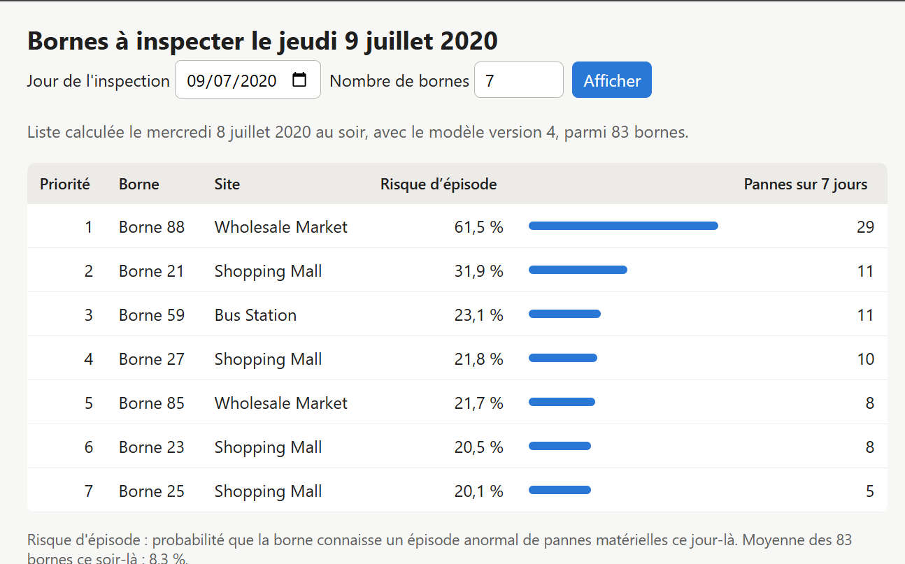
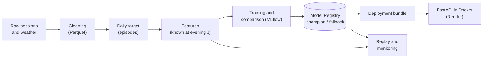
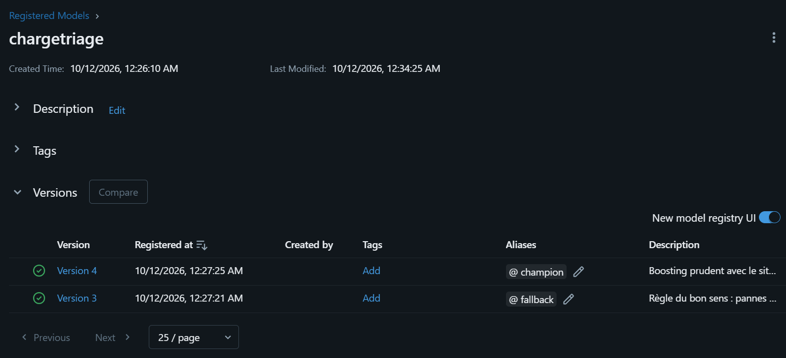
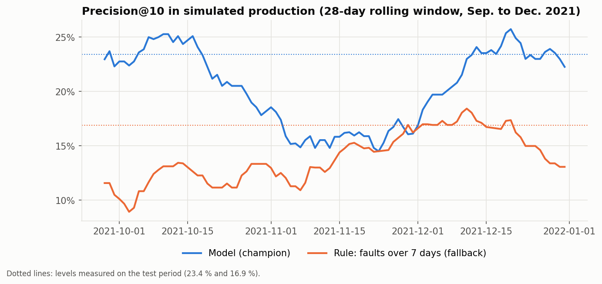

<a id="top"></a>

# ChargeTriage: Daily Inspection Priorities for EV Charging Stations

> A machine learning service that ranks EV charging stations every evening by their risk of an abnormal hardware-fault episode the next day, so that technicians are sent where they are most needed.

**[Live demo](https://chargetriage.onrender.com)** · **[Overview](#overview)** · **[Architecture](#architecture)** · **[Method](#method)** · **[Results](#results)** · **[MLOps](#mlops)** · **[Monitoring](#monitoring)** · **[Installation](#installation)** · **[Limitations](#limitations)**

| | |
|---|---|
| **Problem** | Charging-station operators discover hardware faults after customers have suffered them. With limited technicians, they need to know each evening which stations to inspect first the next day. |
| **Approach** | Defined an "abnormal fault episode" relative to each station's own history, built leakage-free daily features, compared models against common-sense rules with a decision rule fixed in advance, then tracked, registered, served, containerised, tested, monitored and deployed the selected model. |
| **Key result** | On the held-out test period, the 10 stations flagged each evening had an episode the next day in 23.4 % of cases, against 16.9 % for the best common-sense rule (+6.5 points). Over four further months of simulated production, the gap held (20.6 % against 13.5 %). |
| **Stack** | Python · pandas · scikit-learn · MLflow · FastAPI · Docker · GitHub Actions · Render |
| **Context** | Open source |

## Overview

A charging station that fails repeatedly costs the operator twice: an unhappy customer, then an unplanned repair. Inspection capacity is limited, so the useful question is not "will this station ever fail?" but:

* **Which stations should a technician visit tomorrow, in which order?**

**ChargeTriage** answers it every evening with a ranked list. The operator chooses how many stations to inspect (k), and the list is measured on what matters to the operator: among the k stations visited, how many actually had a problem.

**Live demo:** [chargetriage.onrender.com](https://chargetriage.onrender.com) shows the list for any day of the dataset. The service runs on a free plan that sleeps when unused: the first page can take about one minute to load.



## Dataset

| | |
|---|---|
| Source | Zhang et al. (2025), *Scientific Data*. Dataset: doi:10.6084/m9.figshare.28182251.v3 |
| Content | 441,060 charging sessions (January 2020 to December 2021) from 92 charging posts on 13 sites in three districts of Jiaxing (China), with start and end times, energy and the recorded end cause; daily weather per district |
| Integrity | Archive checked against its MD5 checksum before use |
| Licence | CC BY 4.0 |

The data are not stored in this repository. Instructions to download them are in [Installation](#installation).

## Architecture



The registry decides which model is served (alias `champion`). A bundle exports that model and the features, the bundle is added to the API image, and the image is published and run on Render. The same registry feeds the monitoring replay.

## Method

<details>
<summary><b>1. The target: an abnormal fault episode</b></summary>

Raw fault counts mostly point to the busiest stations. The target is therefore relative to each station's own history:

* a session counts as a **hardware fault** when its end cause is one of 8 hardware causes (output, power conversion, switching, input, control loop, communications…). vehicle-side causes are excluded, as are two ambiguous causes (one of them changed meaning in June 2020);
* a station has an **episode** on a given day if it records at least 2 hardware faults **and** a fault rate at least twice its usual level (previous 28 days, day excluded).

Six candidate definitions were compared on criteria fixed before computing them (share of positives, spread across stations, stability over time). The retained one flags 7.3 % of observable station-days, involves all 92 posts and is stable over time.

</details>

<details>
<summary><b>2. Leakage-free features and time-based split</b></summary>

Each row is one station on evening J, the target is an episode on day J+1, and every feature uses only data available on evening J: recent faults (3, 7 and 28 days), fault rates and their trend, past episodes, weak signals (empty or very short sessions), usage, weather and site. 27 features were computed and 19 kept; calendar features and those that only measure the passing of time were dropped.

| Period (predicted day) | Role |
|---|---|
| 2020 | Training |
| January to April 2021 | Validation: model comparison |
| May to August 2021 | Test: opened once |
| September to December 2021 | Simulated production: monitoring |

The split is made before any choice that looks at the link with the target, and an automated test checks that changing the future never changes past features.

</details>

<details>
<summary><b>3. Baselines, models and a decision rule fixed in advance</b></summary>

Five common-sense rules were measured first (random, episode today, faults over 7 days, recent episode, historical rate). The best, **faults over the last 7 days**, reached a precision@10 of 17.3 % on validation: the score to beat.

Logistic regression and gradient boosting (scikit-learn) were then compared, each with and without the site, every run being tracked in MLflow. The decision rule was written before seeing the results: **at least +3 points of precision@10, a bootstrap confidence interval excluding zero, and no month below the rule**.

On validation, the best model (gradient boosting with site) gained +2.9 points: just below the threshold. The threshold was not lowered. The model became a **challenger**, retrained on training and validation data with the same settings, and evaluated once on the test period.

</details>

## Results

**Test period** (May to August 2021, 123 evenings, opened once):

| Metric | Model (champion) | Rule: faults over 7 days |
|---|---|---|
| Precision@10 | **23.4 %** | 16.9 % |
| Recall@10 | **36.3 %** | 26.2 % |
| Precision@5 | **29.3 %** | 21.5 % |
| PR-AUC | **0.280** | 0.156 |
| AUC | **0.771** | 0.708 |

* All three conditions of the decision rule were met: the model was promoted to champion and the rule kept as fallback.
* Base rate: 7.7 % of station-days have an episode. A list of 10 stations is therefore about three times more productive than a random one.
* The model is well calibrated: the average predicted risk was 8.3 % for 7.7 % observed (measured before the data fix below).
* The lists are more diverse than the rule's (61 different stations flagged over the period against 43, before the fix), and less concentrated on the same few stations.

<details>
<summary><b>A data issue found after the test, and how it was handled</b></summary>

The monitoring replay includes an integrity check (rows found = rows expected). It revealed that the source weather file repeats the first day of each month of 2021, which duplicated 1,005 station-days. The loader was fixed, a test was added, and the **same models were re-measured without retraining or re-selecting anything**. Before the fix, precision@10 was 23.5 % against 17.2 % (+6.3 points, 95 % bootstrap interval [+4.1; +8.4], better every month). The figures above are the corrected ones.

</details>

## MLOps

| Step | What was done |
|---|---|
| Experiment tracking | Every run logged in MLflow: parameters, metrics, model, tags |
| Model Registry | Registered model `chargetriage`, aliases `champion` (gradient boosting) and `fallback` (the rule, wrapped as a model). Rollback = moving the alias, no code change |
| Common interface | Model and rule wrapped in the same MLflow `pyfunc` format, both returning a `score` column |
| API | FastAPI with Pydantic validation: `/health`, `/predict`, `/ranking?date=…&k=…`, and `/liste`, a readable French page |
| Deployment bundle | Champion model and evening features exported from the registry into a self-contained folder (the target column removed) |
| Container | Docker image with pinned versions (those recorded by MLflow), non-root user, health check |
| Tests | 57 automated tests: data, units, anti-leakage, API, registry, bundle, monitoring |
| CI | GitHub Actions: tests without the real data, then image build and import check |
| Deployment | Image published on Docker Hub with immutable tags (`api1.2-model4`) and run on Render's free plan; memory and CPU limits checked locally beforehand (295 MB of 512 MB) |



<details>
<summary><b>API endpoints</b></summary>

| Endpoint | For | Returns |
|---|---|---|
| `GET /health` | Monitoring | Status, model name, alias and version, available dates |
| `GET /ranking?date=2021-08-16&k=10` | Software (planning tool) | The k stations to inspect that day, with scores, as JSON |
| `POST /predict` | Software | A score for each station whose 19 features are sent |
| `GET /liste?date=2021-08-16` | People | The same list as a readable page (French) |
| `GET /docs` | Developers | Interactive documentation (OpenAPI) |

</details>

## Monitoring

The four months after the test (September to December 2021) were replayed evening by evening, as in production: list published on evening J, outcome known on evening J+1. The champion and the fallback ran side by side. Alert rules were written in the configuration before the replay.

| Check | Result |
|---|---|
| Performance (precision@10, 28-day rolling, delayed labels) | Champion 20.6 % against 13.5 % for the fallback; ahead at 12 of 14 weekly checks |
| Calibration | 9.2 % predicted, 8.9 % observed |
| Data drift (PSI per feature and month) | Usage features drifted strongly (traffic kept growing); temperature drifted by season |
| Silent stations | The 4 stations of one site that stopped on 28 September were flagged 7 days later |
| Decision | Retraining recommended by the rules |



<details>
<summary><b>What the replay taught</b></summary>

* **Data drift is not performance drift**: usage grew strongly while the model kept its lead, because it relies on rates and on each station compared with itself.
* **The performance alert fired on 30 November for a 0.1-point gap**, less than one inspection over the 28-day window, and December recovered without action. The rule compares two figures without accounting for chance.
* **Temperature drifts every month** against a reference covering all seasons: a seasonal feature needs a seasonal reference.
* These lessons are recorded for the next version of the rules. **The rules were not changed after seeing the results.**
* Retraining was recommended but not performed: the dataset ends in December 2021, so no later data exist to evaluate a retrained model.

</details>

## Installation

Requires Python 3.10+ and Docker. Commands are for Windows PowerShell.

1. Install the project and download the data (archive `Dataset.zip` from the Figshare record, MD5 `d2f43f19a3cfd5d364f97225e5f5d3ab`) into a data folder, by default `C:/dev/ev-reliability-data/raw` (change it with `EVREL_DATA_DIR`):

```powershell
python -m venv .venv
.venv\Scripts\Activate.ps1
python -m pip install -r requirements.txt
python -m pip install -e .
python -m pytest
```

2. Run the notebooks of `exploration/` in order (01 to 10). They clean the data, build the target and features, train and compare the models in MLflow, register the champion and replay production. Notebook 08 opens the test period and notebook 09 registers the models: both are meant to run once, and re-running 09 creates new model versions. MLflow's interface:

```powershell
mlflow ui --backend-store-uri sqlite:///C:/dev/ev-reliability-data/mlflow/mlflow.db
```

3. Serve the champion locally, or in Docker from the deployment bundle:

```powershell
python -m uvicorn api.main:app --reload
python -m evrel.models.bundle
docker build -t chargetriage-api .
docker run --rm -p 8000:8000 -v "C:\dev\ev-reliability-data\bundle:/app/bundle:ro" chargetriage-api
```

The page is then at `http://127.0.0.1:8000/liste` and the API documentation at `http://127.0.0.1:8000/docs`.

<details>
<summary><b>Project structure</b></summary>

```text
ev-charging-reliability/
├── configs/config.yaml      # paths, target definition, split, decision and monitoring rules
├── src/evrel/
│   ├── data/                # loading and cleaning
│   ├── target.py            # hardware faults and episodes
│   ├── features.py          # features known at evening J
│   ├── models/              # baselines, training, evaluation, registry, deployment bundle
│   └── monitoring/          # PSI and production replay
├── api/                     # FastAPI service and readable page
├── tests/                   # 57 automated tests
├── exploration/             # notebooks 01 to 10
├── Dockerfile               # API image (code and pinned dependencies)
├── Dockerfile.deploy        # API image plus the deployment bundle
├── requirements.txt
├── requirements-docker.txt  # versions recorded by MLflow for the model
└── pyproject.toml
```

</details>

## Key Takeaways

* **Defining the target is the hardest modelling decision**: a relative definition (each station against its own history) avoids a model that only points to the busiest stations.
* **A model must beat common sense, not zero**: the rule "faults over 7 days" was the real benchmark.
* **Decision rules written in advance protect against wishful thinking**, including when a model misses the threshold by 0.1 point.
* **A registry with aliases separates "which model" from "how it is served"**: promotion and rollback are one move.
* **Monitoring is more than accuracy**: delayed labels, calibration, drift, silent stations, and alerts that account for chance.
* **Simple integrity checks catch real bugs**: a row count revealed duplicated weather records after the test.

## Limitations

* One city and two years (2020 and 2021, including the COVID-19 period). The model is not expected to transfer as is to another network.
* No maintenance or intervention reports: an episode is inferred from end causes recorded by the stations, not confirmed by a technician.
* Data cleaning and the target definition were designed on the whole period. They do not look at the link between features and target, so the risk is small, but it is not zero.
* The model memorises sites (one-hot site feature): a new site gets no benefit from it.
* The served model is stored with cloudpickle: it must be loaded with the same Python and library versions, which the Docker image pins.
* The online demo serves a fixed history (up to 31 December 2021). There is no live data feed.
* Retraining was recommended by the monitoring rules but not performed, for lack of later data to evaluate it.
* Validation, test and evaluation notebooks keep the figures computed before the weather fix; the corrected test figures are given above.

## Future Improvements

* Alert on performance only when the gap is significant (bootstrap), and compare seasonal features with the same month of the previous year.
* Flag in the list whether a station is already in an episode (confirmation) or shows an early signal (new information).
* Automate the export of the bundle and the image build when a new champion is promoted.
* Add maintenance reports as labels, if an operator can provide them.

## Attribution

Data: Zhang et al. (2025), *Scientific Data*, dataset doi:10.6084/m9.figshare.28182251.v3, licensed under CC BY 4.0. The data were cleaned and transformed for this project (see Method). This project is independent and is not endorsed by the authors of the dataset.

## Author

**Rosette-Michèle Otounga**
Data & AI Engineer · Data Engineering · Applied AI

* [LinkedIn](https://linkedin.com/in/rosette-michele)
* [Portfolio](https://github.com/soley000/omr-portfolio)

<p align="right"><a href="#top">↑ Back to top</a></p>
