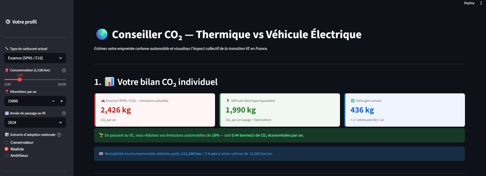
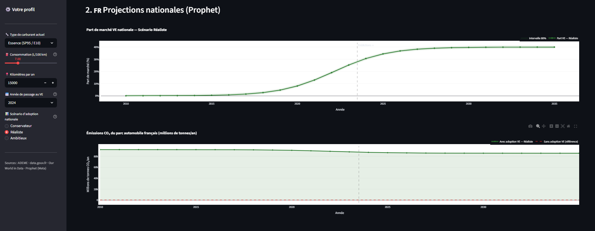
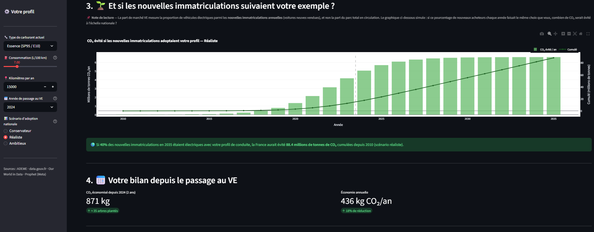
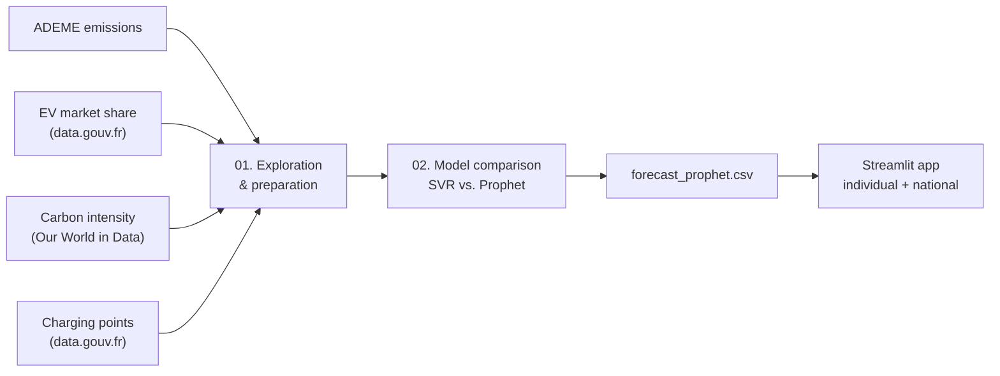

<a id="top"></a>

# CO₂ Reduction: EV Adoption in France

> Quantifying and forecasting the CO₂ reduction from electric vehicle adoption in France, with a personalized Streamlit application.

**[Overview](#overview)** · **[Preview](#preview)** · **[Data](#data-sources)** · **[Model choice](#model-choice-why-prophet)** · **[Application](#application-features)** · **[Installation](#installation-and-usage)** · **[Limitations](#limitations)**

| | |
|---|---|
| **Problem** | How much CO₂ could switching to an EV save, for one driver and for France as a whole? |
| **Approach** | Combined 4 public datasets, compared SVR and Prophet on 14 annual points, forecast EV adoption with logistic growth, computed individual and collective CO₂ gains in an app. |
| **Key result** | Prophet projects the EV share of new registrations to plateau around **2033–2035**; SVR was rejected because it extrapolated outside [0%, 100%]. |
| **Stack** | Python · Pandas · Prophet · scikit-learn · Matplotlib · Streamlit |
| **Context** | Open source |

## Overview

This project quantifies and forecasts the CO₂ reduction generated by the progressive adoption of electric vehicles (EVs) in France. It relies on public data and a Prophet forecasting model, and personalizes the results according to each user's driving habits.

It brings together artificial intelligence and ecology to make the climate impact of mobility choices visible and measurable.

## Objectives

* Build an interactive Streamlit application with environmental business logic.
* Personalize CO₂ estimates by vehicle type, fuel consumption and annual mileage.
* Forecast national EV adoption with Prophet.
* Simulate individual and collective CO₂ gains under different adoption scenarios.

## Preview

| Individual CO₂ balance | Prophet forecast |
|:---:|:---:|
|  |  |

| Collective impact and cumulative balance |
|:---:|
|  |

## Workflow



## Data Sources

| Dataset | Source | Role in the project |
|---|---|---|
| `emissions_vehicules_ademe.csv` | ADEME | Certified CO₂ emissions by vehicle model (g/km). Provides the EV reference value (49.33 g/km) and the combustion reference. |
| `part_marche_ve.csv` | data.gouv.fr | EV share of **annual new registrations**. Target variable for Prophet. |
| `intensite_carbone.csv` | Our World in Data | Electricity carbon intensity (gCO₂/kWh) by country and year. Exploratory analysis only. |
| `points_de_charge.csv` | data.gouv.fr | Public charging points per quarter. Exploratory analysis only. |

<details>
<summary><b>How to read these datasets correctly</b></summary>

* The EV share measures **new registrations**, not the vehicles on the road. A 23.7% share in 2023 means 23.7% of new cars sold that year were electric, not 23.7% of the fleet.
* The ADEME dataset contains only 9 EV models, because EVs have no tailpipe emissions. Their average (49.33 g/km) is used directly; an official ADEME 2023 value serves as a fallback if it is unavailable.
* France's electricity carbon intensity is low thanks to nuclear power (44 gCO₂/kWh in 2024). The 49.33 g/km EV value already reflects the French electricity mix.
* Charging points confirm that adoption and infrastructure grow together, but are not used in the forecast.

</details>

Raw and prepared datasets are excluded from Git because of their size and distribution constraints.

## Model Choice: Why Prophet?

Two models were compared before choosing Prophet.

| Criterion | Prophet | SVR (scikit-learn) |
|---|---|---|
| Model type | Statistical time series | Support vector regression |
| Behavior on 14 annual points | Works well with few points | Memorizes, does not generalize |
| S-shaped adoption curve | Native (`growth='logistic'`) | Not native, uncontrolled extrapolation |
| Values outside [0%, 100%] | Impossible: bounded by `floor=0`, `cap=0.40` | Possible, and observed |
| Confidence intervals | Native | Not available |
| Stability | Stable and reproducible | Sensitive to hyperparameters |

**What was observed.** SVR was tested first. On the 14 training points it reached a very low MAE, but outside that range its predictions became uncontrolled, with negative values or values above 100%. That is physically impossible for a market share, and shows memorization rather than generalization.

Prophet, configured with **logistic growth**, produced predictions consistent with the real market dynamics: gradual take-off until 2020, a marked acceleration, then a realistic plateau around 2033–2035.

<details>
<summary><b>Technical justification</b></summary>

```text
Technology adoption = S-shaped curve
    → slow at first
    → rapid take-off once critical mass is reached
    → plateau when the market saturates

Prophet growth='logistic' models exactly this dynamic.
SVR on 14 points = overfitting, unbounded extrapolation.
```

The comparison is documented and visualized in `notebooks/02_modelisation_prediction_co2.ipynb`, section 5.

</details>

## Application Features

**The user enters:**

* current fuel type;
* average consumption (L/100 km);
* annual mileage;
* the year they switch to an EV;
* a national adoption scenario: conservative (×0.7), realistic (Prophet forecast) or ambitious (×1.4), all capped at 50%.

**The application computes and displays:**

* current annual CO₂ emissions;
* estimated emissions with an EV (use and manufacturing included);
* the annual gain in kg, with an equivalent in trees planted;
* the environmental break-even point, in km and in years.

**Four interactive sections:**

1. Individual CO₂ balance.
2. National Prophet projections (market share and collective emissions).
3. Collective impact if new registrations followed the user's profile.
4. Cumulative balance since switching to an EV.

## Installation and Usage

```bash
pip install -r requirements.txt

# 1. Explore and prepare the data
jupyter notebook notebooks/01_exploration_donnees.ipynb

# 2. Compare models and generate the forecast
jupyter notebook notebooks/02_modelisation_prediction_co2.ipynb

# 3. Launch the application
cd streamlit_app
streamlit run run_app.py
```

<details>
<summary><b>Project structure</b></summary>

```text
co2-ev-france/
├── data/                                  # local only, ignored by Git
│   ├── emissions_vehicules_ademe.csv      # ADEME (sep=";", ISO-8859-1)
│   ├── part_marche_ve.csv                 # data.gouv.fr
│   ├── intensite_carbone.csv              # Our World in Data
│   ├── points_de_charge.csv               # data.gouv.fr (sep=";")
│   └── prepared/                          # generated by notebook 01
│       ├── df_clean.csv
│       ├── df_intensite_fr.csv
│       ├── df_part_annee.csv              # Prophet input
│       ├── df_points_yearly.csv
│       ├── df_fusion.csv
│       └── df_points_part.csv
├── notebooks/
│   ├── 01_exploration_donnees.ipynb       # EDA + data preparation
│   └── 02_modelisation_prediction_co2.ipynb  # SVR vs. Prophet + forecast
├── streamlit_app/
│   ├── run_app.py
│   └── forecast_prophet.csv               # generated by notebook 02
├── requirements.txt
└── README.md
```

</details>

## Technologies

| Category                  | Technologies              |
| ------------------------- | ------------------------- |
| Language                  | Python                    |
| Data manipulation         | Pandas, NumPy             |
| Visualization             | Matplotlib                |
| Forecasting               | Prophet                   |
| Machine Learning baseline | SVR (scikit-learn)        |
| Application               | Streamlit                 |
| Environment               | Jupyter Notebook, VS Code |

## Key Takeaways

* The right model is not the most complex one, but the one that fits the data available: with 14 points, a bounded statistical model beats a flexible ML model.
* A low training error can hide memorization; extrapolation behavior must be checked.
* Domain constraints (a share between 0% and 100%) can be built directly into the model.
* Interpreting the data correctly (new registrations vs. fleet) matters as much as modeling it.

## Limitations

* Only 14 annual observations; uncertainty grows with the projection horizon.
* The forecast covers new registrations, not the full vehicle fleet.
* EV adoption depends on factors not modeled here (prices, incentives, regulation).
* The CO₂ calculation relies on reference values (ADEME averages) rather than real usage data.
* This is a scenario tool, not an official national emissions projection.

## Future Improvements

* Display Prophet's confidence intervals in the application.
* Add explanatory variables (energy prices, incentives, regulation).
* Model the vehicle fleet, not only new registrations.
* Distinguish vehicle categories and usage patterns.
* Deploy the application on Streamlit Community Cloud.

## Author

**Rosette-Michèle Otounga**
Data & AI Engineer · Data Engineering · Applied AI

* [LinkedIn](https://linkedin.com/in/rosette-michele)
* [Portfolio](https://github.com/soley000/omr-portfolio)

<p align="right"><a href="#top">↑ Back to top</a></p>
