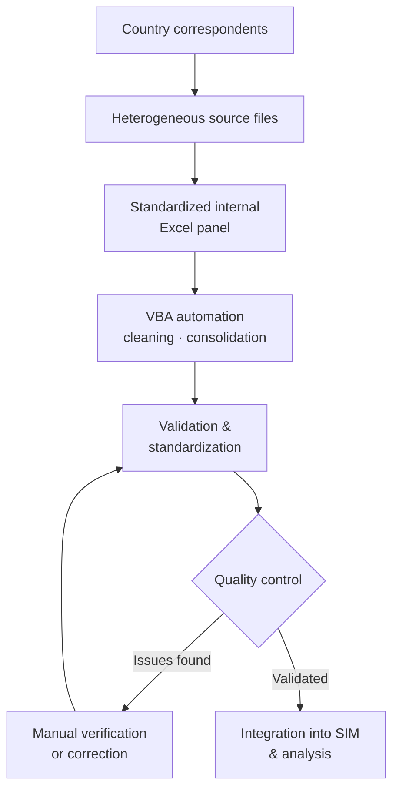

# Industrial Data Automation & Standardization

> Automating and standardizing multi-country commercial data panels to improve data quality and streamline internal database updates.

**[Overview](#overview)** · **[Panels](#what-is-a-panel)** · **[Workflow](#workflow)** · **[Before / After](#before--after-standardization)** · **[Results](#results)** · **[Limitations](#limitations)**

| | |
|---|---|
| **Problem** | Commercial data from country correspondents arrives in heterogeneous formats, making database updates slow and error-prone. |
| **Approach** | Designed a standardized Excel panel, wrote VBA macros for cleaning and consolidation, added validation before integration into the internal statistical tool (SIM). |
| **Key result** | Faster, more reliable multi-country updates, maintained over several years. |
| **Stack** | Microsoft Excel · VBA |
| **Context** | Industrial project — internal data is confidential. |

## Overview

Industrial teams often receive commercial data from multiple country correspondents. Differences in file formats, naming conventions and field completeness make it difficult to integrate this information consistently into an internal statistical database.

This project standardized multi-country Excel panels and automated repetitive preparation tasks with VBA macros, to reduce manual errors, accelerate updates and make multi-country follow-up easier.

## What Is a Panel?

A **panel** is an internal Excel file used by the statistics team to integrate and structure country correspondents' data before loading it into the internal database (SIM). It contains:

* commercial information by country and model;
* vehicle brands and models;
* fuel type, often completed manually;
* sales volumes.

## Objectives

* Harmonize data received from different country correspondents.
* Standardize internal Excel panels.
* Automate repetitive cleaning and consolidation tasks with VBA.
* Check critical fields: brands, models, fuel types and sales volumes.
* Identify incomplete or inconsistent records before integration.
* Maintain consistency across countries and reporting years.

## Workflow

<b>Workflow steps in detail</b>

1. **Source-file analysis**: identify critical fields and differences between country files.
2. **Internal panel creation**: centralize and standardize the information in one Excel structure.
3. **Automated cleaning and consolidation**: VBA macros replace repetitive manual operations.
4. **Field validation**: verify brands, models, fuel types and sales volumes.
5. **Standardization**: harmonize formats and values across countries.
6. **Quality control**: flag missing or inconsistent information before integration.
7. **Database integration**: load validated panels into SIM.
8. **Recurring updates**: maintain consistency across reporting periods and years.

## Before / After Standardization

**Before**: each correspondent uses its own layout and labels.

*Country file A*

| Marque | Modèle | Énergie | Ventes |
|---|---|---|---:|
| RENAULT | CLIO V | ESS | 1 200 |

*Country file B*

| Make | Model name | Fuel | Units sold |
|---|---|---|---:|
| Renault | Clio | Petrol | 1200 |

**After**: one standardized panel, ready for validation and integration.

| Country | Brand | Model | Fuel | Sales |
|---|---|---|---|---:|
| FR | Renault | Clio | Petrol | 1200 |
| ES | Renault | Clio | Petrol | 1200 |

*Illustrative values only, not internal data.*

## Results

* Standardized multi-country data panels.
* Automated cleaning and consolidation operations.
* A reproducible preparation process before database integration.
* Reliable updates to SIM over multiple years.
* Significant time savings and reduced risk of manual errors for the statistics team.

## Technologies

| Category         | Technologies                               |
| ---------------- | ------------------------------------------ |
| Tools            | Microsoft Excel                            |
| Automation       | VBA macros                                 |
| Data preparation | Cleaning, consolidation, standardization   |
| Quality          | Field validation, quality control          |
| Target system    | Internal statistical data tool (SIM)       |

## Key Takeaways

* Automating recurring data-preparation tasks in an industrial environment.
* Structuring heterogeneous inputs into a standardized format.
* Combining automation with validation and quality-control procedures.
* Supporting reliable multi-country reporting over successive years.
* Understanding how upstream data quality determines downstream statistical analysis.

## Limitations

* The workflow relies on office-based tools, which scale poorly as volumes or complexity grow.
* Some fields still require manual verification when source information is incomplete.
* Internal data structures and implementation details cannot be disclosed.

## Future Improvements

* Migrate the preparation steps to Python-based data pipelines.
* Automate additional validation rules and reporting of inconsistent values.
* Separate transformation rules from manual operations.

## Author

**Rosette-Michèle Otounga**
Data & AI Engineer · Data Engineering · Applied AI

* [LinkedIn](https://linkedin.com/in/rosette-michele)
* [Portfolio](https://github.com/soley000/omr-portfolio)

<a href="#top">↑ Back to top</a>

