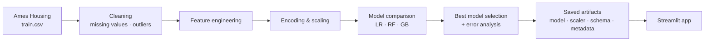
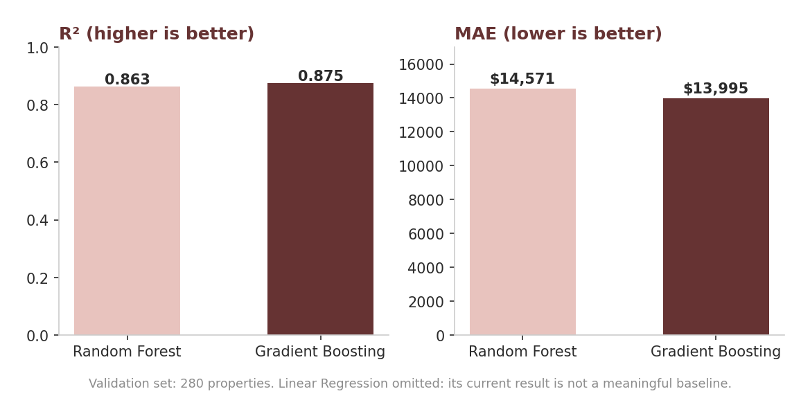
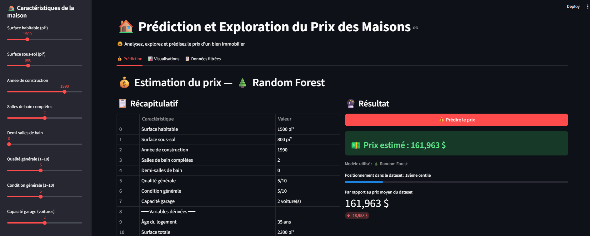
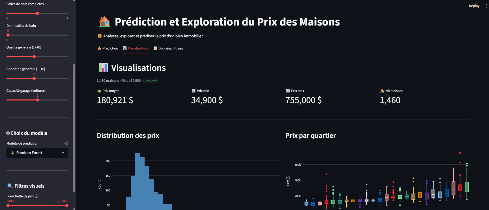
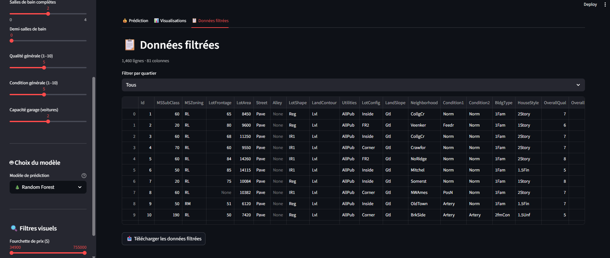

<a id="top"></a>

# Real Estate Price Prediction

> Machine learning regression project for residential property price prediction.

**[Overview](#overview)** · **[Pipeline](#pipeline)** · **[Data](#data)** · **[Modeling](#modeling)** · **[Application](#application)** · **[Installation](#installation-and-usage)** · **[Limitations](#limitations)**

| | |
|---|---|
| **Problem** | Estimate residential property sale prices from structured housing characteristics. |
| **Approach** | Built an end-to-end workflow: cleaning, feature engineering, comparison of three regressors, neighbourhood-level error analysis, Streamlit app. |
| **Key result** | Gradient Boosting: R² = 0.875, MAE ≈ $14K on a 280-property validation set. |
| **Stack** | Python 3.11 · Pandas · scikit-learn · Joblib · Plotly · Streamlit |
| **Context** | Open source |

## Overview

This project predicts residential property prices using structured housing data. It covers an end-to-end machine learning workflow:

* data exploration and cleaning;
* feature engineering based on property characteristics;
* comparison of several regression models;
* evaluation with R² and Mean Absolute Error (MAE);
* prediction error analysis by neighbourhood;
* automatic selection and saving of the best-performing model;
* an interactive Streamlit application.

## Pipeline



## Data

The **Ames Housing dataset** (Kaggle): residential property characteristics and their sale prices.

| Data                         | Purpose                                                  |
| ---------------------------- | -------------------------------------------------------- |
| **Property characteristics** | Surface, quality, condition and construction information |
| **Building information**     | Year built, basement and living areas                    |
| **Bathrooms**                | Full and half bathrooms                                  |
| **Garage**                   | Garage capacity                                          |
| **Neighbourhood**            | Geographic and market-related information                |
| **SalePrice**                | Target variable                                          |

`train.csv` and `test.csv` are kept locally in `data/` and excluded from Git.

<details>
<summary><b>Data preparation steps</b></summary>

1. Load the dataset and explore its structure and missing values.
2. Handle missing numerical and categorical values.
3. Remove extreme observations with an IQR-based approach.
4. Create engineered features.
5. One-hot encode categorical variables.
6. Split into training and validation sets.
7. Scale the feature matrix.
8. Save the final feature schema used by the model.

</details>

| Step                          | Value |
| ----------------------------- | ----: |
| Initial training observations | 1,460 |
| SalePrice outliers removed    |    61 |
| Rows after cleaning           | 1,399 |
| Encoded features              |   254 |

### Feature engineering

```text
AgeLogement    = 2025 - YearBuilt
SurfaceTotale  = GrLivArea + TotalBsmtSF
NbSallesDeBain = FullBath + 0.5 × HalfBath
```

The original variables used in these transformations are removed from the modelling dataset.

## Modeling

Three models, trained on the same feature matrix and evaluated on the same validation set (280 observations):

| Model                 |         R² |         MAE |
| --------------------- | ---------: | ----------: |
| Linear Regression     |  -186.7257 |    $766,294 |
| Random Forest         |     0.8626 |     $14,571 |
| **Gradient Boosting** | **0.8750** | **$13,995** |



**Gradient Boosting** gives the best validation performance. The Linear Regression result is not a meaningful baseline in its current form and requires further investigation (for example regularized regression or a log-transformed target).

### Error analysis by neighbourhood

Beyond global metrics, the project analyzes MAE per neighbourhood, alongside the number of properties per neighbourhood. This exploratory diagnostic highlights areas where the model is less accurate; it does not establish the cause of these differences.

<details>
<summary><b>Saved artifacts</b></summary>

```text
models/
├── feature_columns.pkl
├── gradient_boosting_model.pkl
├── model_metadata.json
└── scaler.pkl
```

`model_metadata.json` stores the selected model name, filename and metrics, so the Streamlit application loads whichever model the training pipeline selected.

</details>

## Application

| Price prediction | Model visualisations |
|:---:|:---:|
|  |  |

| Data exploration |
|:---:|
|  |

The user enters property characteristics (living area, basement area, year built, bathrooms, overall quality and condition, garage capacity) and can choose the model: Random Forest, Gradient Boosting or Linear Regression. The application then:

1. applies the same feature engineering as during training;
2. aligns the features with the saved training schema;
3. applies the saved scaler;
4. loads the selected model;
5. returns the predicted price.

## Installation and Usage

```bash
git clone https://github.com/soley000/omr-portfolio.git
cd omr-portfolio/projects/supporting/real-estate-price-prediction
pip install -r requirements.txt
```

Place `train.csv` and `test.csv` in `data/`, then:

1. Run `notebooks/house_price_analysis.ipynb` from start to finish to train, evaluate and save the model.
2. Launch the application:

```bash
streamlit run app_streamlit.py
```

<details>
<summary><b>Project structure</b></summary>

```text
real-estate-price-prediction/
├── data/                  # local only, ignored by Git
│   ├── train.csv
│   └── test.csv
├── models/
│   ├── feature_columns.pkl
│   ├── gradient_boosting_model.pkl
│   ├── model_metadata.json
│   └── scaler.pkl
├── notebooks/
│   └── house_price_analysis.ipynb
├── src/
│   ├── __init__.py
│   ├── feature_engineering.py
│   ├── modeling.py
│   └── preprocessing.py
├── app_streamlit.py
├── requirements.txt
├── .gitignore
└── README.md
```

</details>

## Technologies

| Category          | Technologies                                        |
| ----------------- | --------------------------------------------------- |
| Language          | Python 3.11                                         |
| Data manipulation | Pandas, NumPy                                       |
| Machine Learning  | scikit-learn                                        |
| Models            | Linear Regression, Random Forest, Gradient Boosting |
| Preprocessing     | One-hot encoding, feature scaling, IQR filtering    |
| Model persistence | Joblib, JSON                                        |
| Visualization     | Matplotlib, Seaborn, Plotly                         |
| Application       | Streamlit                                           |
| Environment       | Jupyter Notebook, VS Code                           |

## Key Takeaways

* Tree-based ensembles perform well on this dataset and feature representation; Gradient Boosting gives the best validation results.
* Global metrics should be complemented by error analysis, here by neighbourhood.
* Separating preprocessing artifacts, model artifacts and metadata makes the model reusable in an application.

## Limitations

* The dataset represents a single real estate market and does not generalize to other markets.
* Validation results do not guarantee performance on future transactions.
* Outlier removal changes the distribution of the data.
* No external economic, geographic or temporal market information is used.
* The application is a demonstration, not a professional valuation tool.

## Future Improvements

* Cross-validation and hyperparameter optimization.
* Regularized linear baseline (Ridge / Lasso).
* Model explainability with SHAP.
* API-based model serving, monitoring and drift detection.
* Additional geographic and market-level features.

## Author

**Rosette-Michèle Otounga**
Data & AI Engineer · Data Engineering · Applied AI

* [LinkedIn](https://linkedin.com/in/rosette-michele)
* [Portfolio](https://github.com/soley000/omr-portfolio)

<p align="right"><a href="#top">↑ Back to top</a></p>
